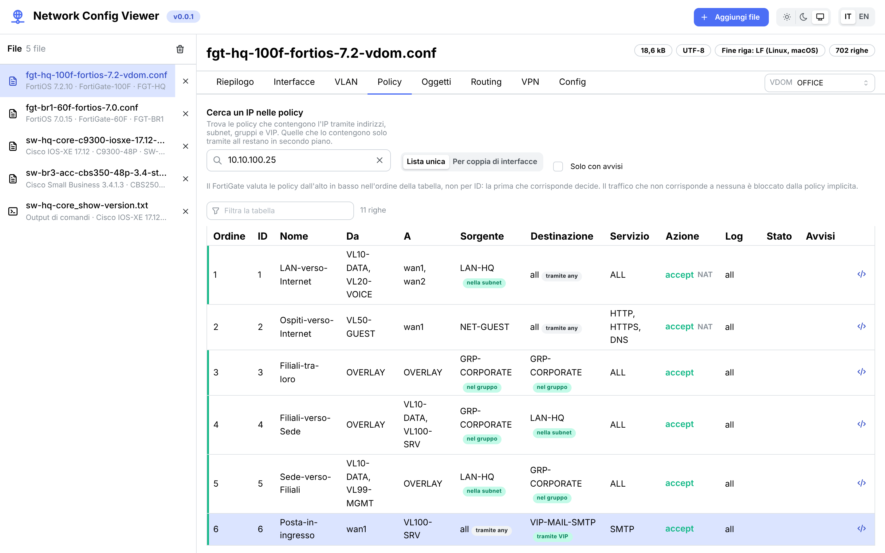
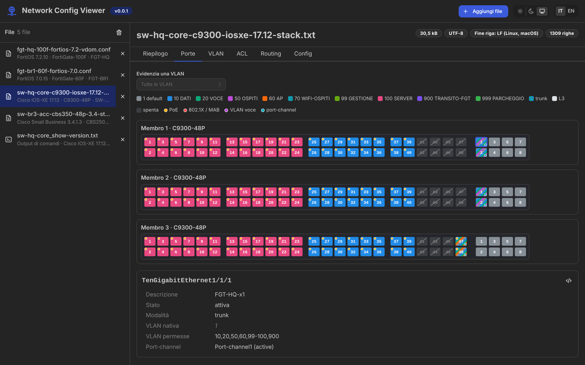

# Network Config Viewer

Strumento per vedere l'infrastruttura di rete di un cliente partendo dai backup di configurazione degli apparati. Gira tutto sul tuo PC: le config vengono lette nel browser e non vengono mai inviate da nessuna parte.

## Stato del progetto

Versione 0.0.1, con la fase 0 della roadmap e la prima parte della fase 1: trascini un backup FortiGate o Cisco e l'app lo legge e lo mostra in forma grafica, apparato per apparato, sempre collegato alla config originale, identica al file.

Della fase 1 mancano ancora la lettura degli show con lo stato reale, l'archivio dei clienti sul PC e l'export Excel. Le fasi successive (mappa dell'infrastruttura, analisi, rack, migrazioni) sono descritte nello [studio](docs/STUDIO.md). Il [mockup](docs/mockup/index.html) mostra con dati di esempio come potrebbero apparire le viste future: scaricalo e aprilo nel browser.

## Cosa fa oggi

- **Carica più file insieme**, anche dentro archivi zip, tar, tar.gz e gz, anche uno dentro l'altro. Si può trascinare anche una cartella intera.
- **Riconosce** marca, sistema operativo, versione, modello, hostname, stack e VDOM, e per ogni dato mostra la riga da cui viene. Se sbaglia, si corregge a mano.
  - FortiGate (FortiOS) e FortiSwitch, Cisco IOS e IOS-XE, Cisco Small Business. Cisco NX-OS e ASA vengono riconosciuti, ma non ancora letti.
  - Output dei comandi show, con o senza prompt.
- **Legge le config** di FortiGate (FortiOS 7.0–8.0, anche con VDOM multiple), Cisco IOS e IOS-XE e Cisco Small Business, e per ogni apparato mostra le sue viste:
  - **riepilogo**: IP di gestione, stack o VDOM, conteggi, funzioni in uso, avvisi e copertura della lettura, con le sezioni non interpretate;
  - **switch**: pannello delle porte di ogni membro dello stack (colori per VLAN, trunk a strisce, porte spente, L3, PoE, 802.1X/MAB, VLAN voce, port-channel), VLAN con porte e gateway, ACL con la ricerca per IP, routing;
  - **FortiGate**: interfacce e zone, VLAN, policy nell'ordine reale (lista unica o per coppia di interfacce) con la ricerca per IP anche tramite subnet, gruppi, VIP e "all", oggetti con "dove è usato", routing, VPN IPsec, SD-WAN.
- **Indica i valori di default**: quello che la config non scrive ma l'apparato usa è in corsivo, e i default ancora da confermare su apparati reali sono segnati "da verificare".
- **Mostra la config originale** con evidenziazione, blocchi piegabili, numeri di riga, ricerca e una struttura navigabile: blocchi `config`, VDOM, interfacce, banner… Per gli apparati letti, i nomi portano alla loro definizione, le righe non interpretate sono evidenziate e da ogni elemento delle viste si salta alle sue righe.
- **Non modifica mai le config**: il testo si copia o si scarica identico al file, byte per byte, anche con i fine riga di Windows.
- **Segnala i file che non si possono leggere**: binari, vuoti, archivi danneggiati o protetti da password, backup FortiGate cifrati.
- Interfaccia in **italiano e inglese**, a scelta.
- Tema **chiaro, scuro o come il sistema**, a scelta. La scelta resta salvata nel browser.

## Come avviarlo

Serve Docker:
- su Windows e macOS, Docker Desktop;
- su Linux, Docker Engine.

Docker Desktop è gratuito per uso personale e per le aziende con meno di 250 dipendenti e meno di 10 milioni di fatturato. In alternativa vanno bene Podman Desktop o Rancher Desktop, gratuiti.

1. Scarica il codice: `git clone https://github.com/TehMaat/Network-Config-Viewer.git`, oppure *Code → Download ZIP* su GitHub.
2. Nella cartella del codice lancia `docker compose up -d`.
3. Apri http://localhost:8080.

La prima volta Docker scarica il necessario e costruisce l'immagine: serve internet e ci vuole qualche minuto. Dopo, l'app funziona anche senza rete.

| Per… | Comando |
|---|---|
| aggiornare | `git pull`, poi `docker compose up -d --build` |
| fermare | `docker compose down` |
| usare un'altra porta | `NCV_PORT=9090 docker compose up -d` (in PowerShell: `$env:NCV_PORT=9090; docker compose up -d`) |

## Riservatezza

- I file vengono letti ed elaborati nel browser: non arrivano a nessun server, nemmeno al container, che contiene solo un web server con i file dell'app.
- L'app risponde solo al tuo PC (`127.0.0.1`): gli altri computer della rete non la raggiungono.
- Il browser riceve una regola di sicurezza (Content Security Policy) che blocca qualsiasi collegamento ad altri siti. I test automatici lo verificano.
- Nessuna telemetria, nessun font o script scaricato da fuori.
- Nella repo, nei test, nella documentazione e negli screenshot ci sono solo dati inventati: vedi [`samples/`](samples/README.md).

## Sviluppo

Serve Node.js 22.12 o successivo (i test automatici usano la versione 24).

| Comando | Cosa fa |
|---|---|
| `npm install` | Installa le dipendenze |
| `npm run dev` | Avvia l'app in sviluppo su http://localhost:5173 |
| `npm test` | Test unitari (Vitest) |
| `npm run lint`, `npm run typecheck`, `npm run format:check` | Controlli del codice |
| `npm run build` | Costruisce l'app in `packages/web/dist` |
| `npm run test:e2e` | Test nel browser (Playwright) sulla build, servita con le stesse regole di sicurezza del container. Con `NCV_BASE_URL=http://127.0.0.1:8080` li esegue sul container |

La prima volta, per i test nel browser: `npx playwright install chromium`.

Struttura del codice:
- `packages/core`: lettura dei file e degli archivi, riconoscimento, parser, driver di marca, modello neutro e funzioni di ricerca sul modello. TypeScript senza dipendenze dal browser, così potrà girare anche sul server.
- `packages/web`: interfaccia React con Mantine, CodeMirror, TanStack Table e i18next. Le viste degli apparati sono in `packages/web/src/views`, le traduzioni in `packages/web/src/i18n`.
- `samples`: config di esempio sintetiche, con il riconoscimento atteso in `expected.json` e il riassunto atteso del modello in `expected-models.json`.
- `docker`: configurazione di nginx e delle regole di sicurezza; `Dockerfile` e `compose.yaml` sono nella radice.

Gli screenshot in `docs/img/app-*.png`, in tema chiaro e in tema scuro (`-scuro`), si rigenerano con `NCV_SCREENSHOTS=1 npm run test:e2e -- screenshots`.

## Come si lavora

- Ogni proposta viene analizzata e diventa un'issue; il lavoro parte solo dopo l'okay. Le regole complete sono in [CLAUDE.md](CLAUDE.md).
- Tutte le modifiche sono annotate nel [registro delle modifiche](CHANGELOG.md), con le versioni secondo il Semantic Versioning.
- A ogni pull request GitHub Actions esegue lint, controllo dei tipi, test, build, immagine Docker e test nel browser sul container. Non si pubblica niente.

## Licenza

[MIT](LICENSE)
