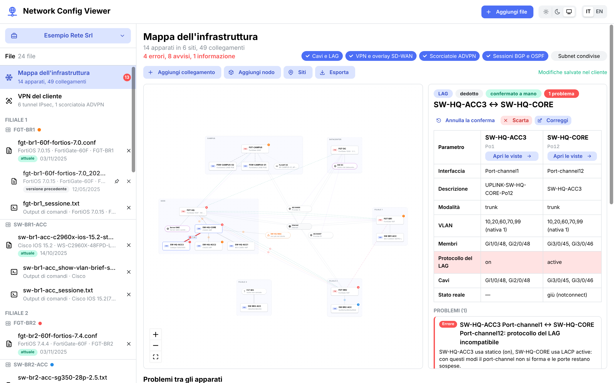
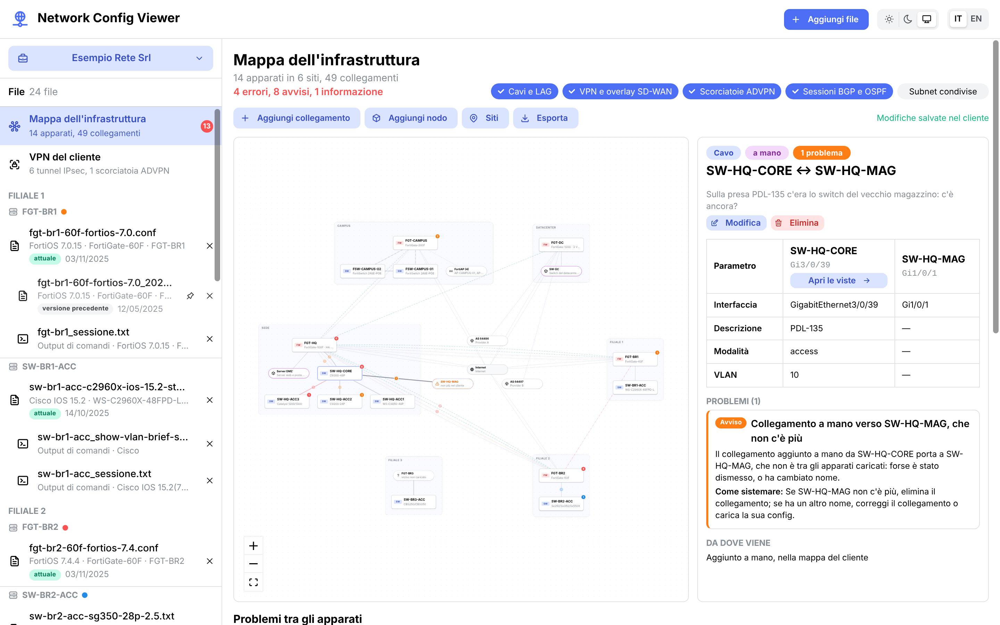
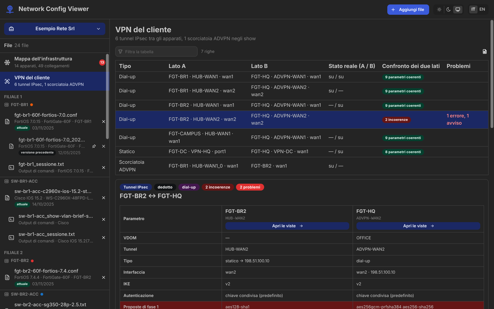
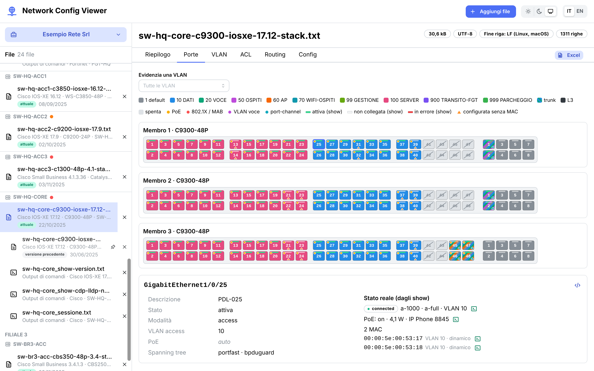
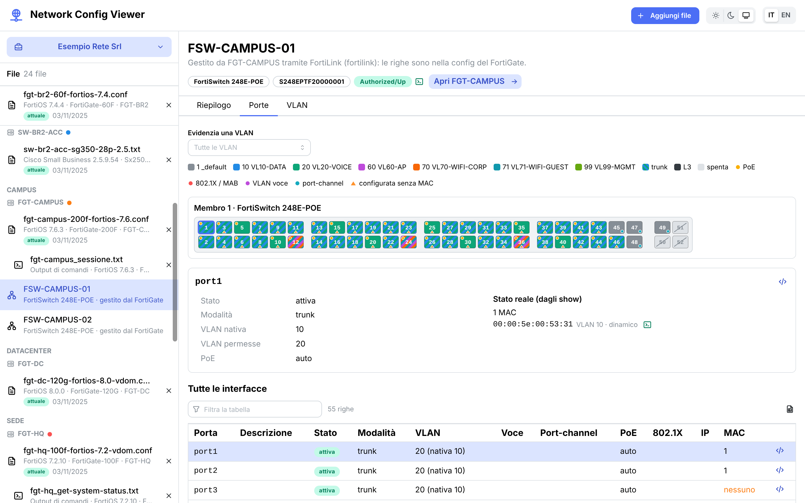

# Network Config Viewer

Strumento per vedere l'infrastruttura di rete di un cliente partendo dai backup di configurazione degli apparati. Gira tutto sul tuo PC: le config vengono lette nel browser, conservate nell'archivio dell'app sul PC e non vengono mai inviate altrove.

## Stato del progetto

Le fasi 0 e 1 della roadmap sono realizzate: trascini un backup FortiGate o Cisco e l'app lo legge e lo mostra in forma grafica, apparato per apparato, sempre collegato alla config originale, identica al file. Se aggiungi gli output dei comandi show, le viste mostrano anche lo stato reale. I file di ogni cliente restano nell'archivio dell'app, sul PC, raggruppati per apparato, e ogni apparato si esporta in Excel.

Anche la fase 2 è realizzata: gli apparati di un cliente si vedono insieme nella **mappa dell'infrastruttura**, con i **problemi** trovati confrontandoli tra loro, e nella **vista VPN** del cliente, con ADVPN. La mappa si **corregge a mano** e si **esporta** in draw.io, PNG e SVG. I **FortiSwitch e i FortiAP gestiti dal FortiGate** sono apparati del cliente, con le loro viste e sulla mappa. Le fasi successive (analisi, rack, migrazioni) sono descritte nello [studio](docs/STUDIO.md). Il [mockup](docs/mockup/index.html) mostra con dati di esempio come potrebbero apparire le viste future: scaricalo e aprilo nel browser.

## Cosa fa oggi

- **Carica più file insieme**, anche dentro archivi zip, tar, tar.gz e gz, anche uno dentro l'altro. Si può trascinare anche una cartella intera.
- **Conserva i file di ogni cliente** nell'archivio dell'app, sul PC: crei un cliente e ci carichi config, show e versioni precedenti, anche in più volte. L'app li ritrova sempre, da qualsiasi browser, anche dopo averlo pulito o dopo aver aggiornato l'app, e li tiene identici all'originale.
  - Raggruppa i file per apparato: la config attuale, le versioni precedenti e gli show. L'attuale è la più recente, per la data scritta nella config, nel nome del file o del file stesso; se serve, si sceglie a mano.
  - Le correzioni a mano restano salvate con il cliente.
  - Un cliente si esporta in un file zip, come copia di sicurezza o per passarlo a un collega, e si reimporta. Per provare l'app c'è un cliente di esempio da importare: [`samples/cliente-esempio.zip`](samples/cliente-esempio.zip).
  - Senza un cliente aperto i file restano solo nella scheda del browser: va bene per un'occhiata veloce.
- **Riconosce** marca, sistema operativo, versione, modello, hostname, stack e VDOM, e per ogni dato mostra la riga da cui viene. Se sbaglia, si corregge a mano.
  - FortiGate (FortiOS) e FortiSwitch, Cisco IOS e IOS-XE, Cisco Small Business. Cisco NX-OS e ASA vengono riconosciuti, ma non ancora letti. I FortiSwitch autonomi vengono riconosciuti; quelli gestiti dal FortiGate si leggono dalla sua config.
  - Output dei comandi show, con o senza prompt.
- **Legge le config** di FortiGate (FortiOS 7.0–8.0, anche con VDOM multiple), Cisco IOS e IOS-XE e Cisco Small Business, e per ogni apparato mostra le sue viste:
  - **riepilogo**: IP di gestione, stack o VDOM, conteggi, funzioni in uso, avvisi e copertura della lettura, con le sezioni non interpretate;
  - **switch**: pannello delle porte di ogni membro dello stack (colori per VLAN, trunk a strisce, porte spente, L3, PoE, 802.1X/MAB, VLAN voce, port-channel), VLAN con porte e gateway, ACL con la ricerca per IP, routing;
  - **FortiGate**: interfacce e zone, VLAN, policy nell'ordine reale (lista unica o per coppia di interfacce) con la ricerca per IP anche tramite subnet, gruppi, VIP e "all", oggetti con "dove è usato", routing, VPN IPsec, SD-WAN;
  - **FortiSwitch gestiti dal FortiGate**: l'elenco degli switch con la coppia MCLAG (l'ICL e i trunk su tutti e due gli switch), e per ogni switch la sua pagina, sotto il FortiGate nell'elenco a sinistra: riepilogo, pannello delle porte e VLAN, con i colori delle VLAN del FortiGate e le righe della config del FortiGate;
  - **FortiAP gestiti dal FortiGate**: SSID con sicurezza, server RADIUS, VLAN e traffico, access point con modello, profilo e SSID, profili con le radio.
- **Legge gli output dei comandi show** di Cisco IOS e IOS-XE, Cisco Small Business e FortiGate, da file singoli o da log di sessione, e li abbina da solo al loro apparato: per hostname, numero di serie o nome del file, con la correzione a mano. Le viste mostrano lo stato reale accanto alla config, e ogni dato porta alla sua riga dello show:
  - **switch**: stato delle porte, vicini CDP e LLDP, PoE, nomi delle VLAN tenute dal VTP e i **MAC dei dispositivi collegati** a ogni porta configurata (con l'IP, se lo switch ha la tabella ARP), con un segno sulle porte configurate senza MAC: forse non sono usate;
  - **FortiGate**: stato delle interfacce e dei tunnel IPsec (anche dial-up), tabella di routing reale, sessioni BGP, health check SD-WAN e membro in uso da ogni regola;
  - **FortiSwitch gestiti**: dallo show del FortiGate lo stato di ogni switch, e i MAC sulle sue porte, con lo stesso segno sulle porte configurate senza MAC. I formati di questi due comandi sono da verificare con un output reale.
- **Mette insieme gli apparati di un cliente nella mappa dell'infrastruttura**, che si apre dall'elenco a sinistra, sopra gli apparati raggruppati per sito:
  - i siti vengono dalla location SNMP, dal codice nell'hostname (FGT-BR1, SW-BR1-ACC) o dai cavi;
  - i collegamenti: cavi e LAG dai vicini LLDP e CDP o dalle descrizioni delle porte, subnet condivise, uscite Internet, tunnel IPsec (anche verso hub dial-up), sessioni BGP (anche nei `neighbor-range` dell'hub), adiacenze OSPF e scorciatoie ADVPN viste negli show; ognuno dice se è **verificato** da uno show o **dedotto** dalla config;
  - i FortiSwitch gestiti, collegati al loro FortiGate con la FortiLink, i due switch di una coppia MCLAG uniti dall'ICL, e i FortiAP come un gruppo sotto il FortiGate;
  - livelli che si accendono e si spengono; il clic su un collegamento mostra i due lati affiancati, parametro per parametro, con i pulsanti che aprono la config o lo show alla riga, e il clic su un apparato apre le sue viste;
  - con gli show, lo stato reale dei due lati: porte, tunnel, sessioni BGP, health check SD-WAN;
  - sotto la mappa, l'elenco dei collegamenti con filtro ed export Excel; nelle viste di ogni apparato, l'altro estremo di porte, tunnel e sessioni BGP porta all'altro apparato.
- **Controlla gli apparati di un cliente a vicenda** e segnala quello che non torna, con la gravità (errore, avviso, informazione), il perché, come sistemarlo e le righe dei due lati:
  - tunnel IPsec (versione IKE, autenticazione, proposte e gruppi DH, selettori, PFS, ruoli ADVPN), sessioni BGP (AS, neighbor, sessione giù), trunk (modalità, VLAN nativa e permesse), LAG, MTU, OSPF, IP duplicati e subnet sovrapposte tra siti, rotte annunciate che mancano nella tabella di routing, descrizioni in contrasto con LLDP e CDP, porte con LLDP e CDP spenti, ADVPN;
  - un valore che viene da un default non ancora confermato non dà mai errore, ma un avviso "da verificare";
  - i problemi sono segnati sulla mappa, sugli apparati e sui collegamenti, elencati sotto la mappa (con export Excel), nel dettaglio di ogni collegamento con i valori che non tornano colorati, e nel riepilogo di ogni apparato.
- **Mostra la VPN del cliente**: tutti i tunnel con i due estremi, il tipo, lo stato e l'esito del confronto ("9 parametri coerenti", "2 incoerenze", "un solo lato"); per ADVPN ruoli, controlli e, per ogni coppia di filiali, se la scorciatoia è attiva, possibile o no, e perché.
- **Trova il gateway di una VLAN** anche su un altro apparato, seguendo i trunk: nella vista VLAN di uno switch di accesso compare il FortiGate o il centro stella che fa da gateway, con il percorso.
- **Si corregge a mano**, e le modifiche restano nel cliente, in `map.json`, senza mai toccare le config:
  - apparati e nodi si spostano trascinandoli; i siti si rinominano e si uniscono, e un apparato si sposta in un altro sito;
  - si aggiungono nodi senza config (un router del provider, un NAS) e collegamenti da porta a porta: cavi, LAG, WAN private;
  - i collegamenti dedotti si confermano, si scartano (e si ripristinano) o si correggono;
  - un collegamento a mano verso un apparato che non c'è più resta, ed è segnalato;
  - senza un cliente aperto le modifiche restano nella scheda, e vanno nel cliente con i file.
- **Esporta la mappa** in draw.io, da ritoccare, e come immagine PNG o SVG, con i livelli accesi.
- **Esporta in Excel**, con il file creato nel browser:
  - ogni apparato, con un foglio per vista: porte, VLAN, ACL, routing e MAC degli switch; interfacce e VLAN del FortiGate, e policy, oggetti, routing, VPN e SD-WAN di ogni VDOM. Con gli show c'è anche lo stato reale;
  - ogni tabella, così come è filtrata e ordinata, con il pulsante accanto al filtro.
- **Indica i valori di default**: quello che la config non scrive ma l'apparato usa è in corsivo, e i default ancora da confermare su apparati reali sono segnati "da verificare".
- **Mostra la config originale** con evidenziazione, blocchi piegabili, numeri di riga, ricerca e una struttura navigabile: blocchi `config`, VDOM, interfacce, banner… Per gli apparati letti, i nomi portano alla loro definizione, le righe non interpretate sono evidenziate e da ogni elemento delle viste si salta alle sue righe.
- **Non modifica mai le config**: il testo si copia o si scarica identico al file, byte per byte, anche con i fine riga di Windows.
- **Segnala i file che non si possono leggere**: binari, vuoti, archivi danneggiati o protetti da password, backup FortiGate cifrati.
- Interfaccia in **italiano e inglese**, a scelta.
- Tema **chiaro, scuro o come il sistema**, a scelta. La scelta resta salvata nel browser.

## Come avviarlo

Serve Docker:
- su Windows e macOS, Docker Desktop;
- su Linux, Docker Engine.

Docker Desktop è gratuito per uso personale e per le aziende con meno di 250 dipendenti e meno di 10 milioni di fatturato. In alternativa vanno bene Podman Desktop o Rancher Desktop, gratuiti.

1. Scarica il codice: `git clone https://github.com/TehMaat/Network-Config-Viewer.git`, oppure *Code → Download ZIP* su GitHub.
2. Nella cartella del codice lancia `docker compose up -d`.
3. Apri http://localhost:8080.

La prima volta Docker scarica il necessario e costruisce l'immagine: serve internet e ci vuole qualche minuto. Dopo, l'app funziona anche senza rete.

| Per… | Comando |
|---|---|
| aggiornare | `git pull`, poi `docker compose up -d --build` (l'archivio dei clienti resta) |
| fermare | `docker compose down` |
| usare un'altra porta | `NCV_PORT=9090 docker compose up -d` (in PowerShell: `$env:NCV_PORT=9090; docker compose up -d`) |

### L'archivio dei clienti

- I clienti stanno nel volume Docker `ncv-data`, sul PC: restano quando fermi, riavvii o aggiorni l'app.
- **Non usare mai `docker compose down -v`**: `-v` cancella il volume e con lui tutti i clienti. Lo stesso succede ripristinando Docker Desktop ai valori di fabbrica o cancellandone i dati.
- Su Windows e macOS il volume sta dentro Docker e non si apre come una cartella normale. Per avere i file a portata di mano, e come copia di sicurezza, esporta il cliente dall'app: menu del cliente, *Esporta in un file zip*.

## Riservatezza

- I file vengono letti ed elaborati nel browser. Quando li salvi in un cliente vanno al container, sul tuo PC, che li conserva nel suo volume così come sono: non arrivano a nessun altro server.
- L'app risponde solo al tuo PC (`127.0.0.1`): gli altri computer della rete non la raggiungono.
- Il server dell'archivio accetta solo richieste indirizzate a `localhost`, `127.0.0.1` o `[::1]` e modifiche che arrivano dall'app: una pagina di un altro sito aperta nel browser non può leggere né cambiare l'archivio. Gira senza privilegi di amministratore, con il filesystem in sola lettura tranne il volume dei dati, e sceglie lui i nomi dei file sul disco.
- Il browser riceve una regola di sicurezza (Content Security Policy) che blocca qualsiasi collegamento ad altri siti. I test automatici lo verificano.
- Nessuna telemetria, nessun font o script scaricato da fuori.
- Nella repo, nei test, nella documentazione e negli screenshot ci sono solo dati inventati: vedi [`samples/`](samples/README.md).

## Sviluppo

Serve Node.js 22.12 o successivo (i test automatici usano la versione 24).

| Comando | Cosa fa |
|---|---|
| `npm install` | Installa le dipendenze |
| `npm run dev` | Avvia l'app in sviluppo su http://localhost:5173, senza l'archivio dei clienti |
| `npm start` | Avvia il server dell'app sulla build, su http://localhost:8080, con l'archivio in `packages/server/data` |
| `npm test` | Test unitari (Vitest) |
| `npm run lint`, `npm run typecheck`, `npm run format:check` | Controlli del codice |
| `npm run build` | Costruisce l'app in `packages/web/dist` e il server in `packages/server/dist` |
| `npm run test:e2e` | Test nel browser (Playwright) sul server dell'app, con un archivio vuoto in una cartella temporanea (prima `npm run build`). Con `NCV_BASE_URL=http://127.0.0.1:8080` li esegue sul container; con `NCV_ALL_BROWSERS=1` anche su Firefox e WebKit |

La prima volta, per i test nel browser: `npx playwright install chromium`, e con `NCV_ALL_BROWSERS=1` anche `firefox webkit`.

Struttura del codice:
- `packages/core`: lettura dei file e degli archivi, riconoscimento, parser, driver di marca, modello neutro, funzioni di ricerca sul modello e correlazione degli apparati di un cliente (`src/correlate`). TypeScript senza dipendenze dal browser, così potrà girare anche sul server.
- `packages/web`: interfaccia React con Mantine, CodeMirror, TanStack Table e i18next. Le viste degli apparati sono in `packages/web/src/views`, la mappa in `packages/web/src/map` (React Flow e dagre), i clienti e l'archivio in `packages/web/src/archive`, le traduzioni in `packages/web/src/i18n`.
- `packages/server`: il server dell'app, con Fastify: serve l'app e conserva l'archivio dei clienti. Le regole di sicurezza inviate al browser sono in `packages/server/src/security-headers.json`, unica fonte anche per i test.
- `samples`: config di esempio sintetiche, con il riconoscimento atteso in `expected.json`, il riassunto atteso del modello in `expected-models.json`, i collegamenti attesi tra gli apparati in `expected-links.json` e il cliente di esempio `cliente-esempio.zip`.
- `Dockerfile` e `compose.yaml` sono nella radice.

Gli screenshot in `docs/img/app-*.png`, in tema chiaro e in tema scuro (`-scuro`), si rigenerano con `NCV_SCREENSHOTS=1 npm run test:e2e -- screenshots`, da soli: svuotano l'archivio del server di prova e importano il cliente di esempio.

## Come si lavora

- Ogni proposta viene analizzata e diventa un'issue; il lavoro parte solo dopo l'okay. Le regole complete sono in [CLAUDE.md](CLAUDE.md).
- Tutte le modifiche sono annotate nel [registro delle modifiche](CHANGELOG.md), con le versioni secondo il Semantic Versioning. Ogni pull request unita è una versione: la CI crea da sola il tag e la [release](https://github.com/TehMaat/Network-Config-Viewer/releases) con le note del registro.
- A ogni pull request GitHub Actions esegue lint, controllo dei tipi, test, build, immagine Docker e test nel browser sul container, con Chromium, Firefox e WebKit, compreso l'archivio che resta dopo il riavvio e l'aggiornamento del container. Non si pubblica niente.

## Licenza

[MIT](LICENSE)
