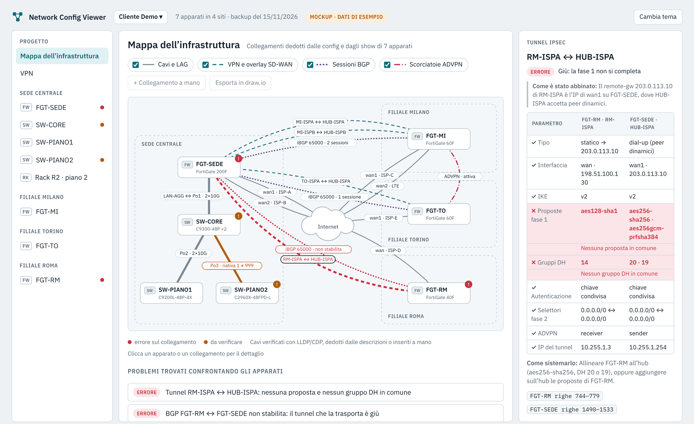
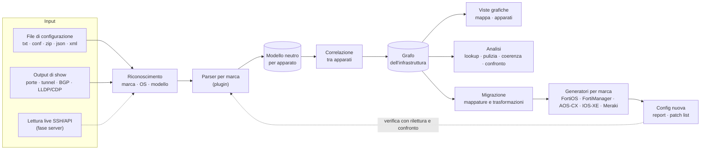
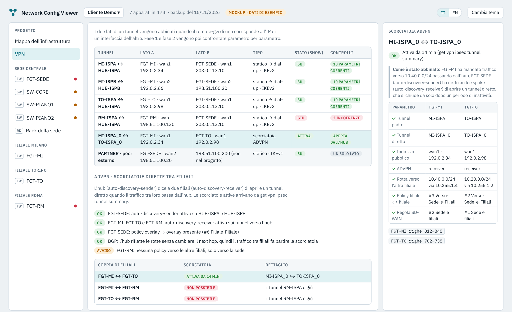
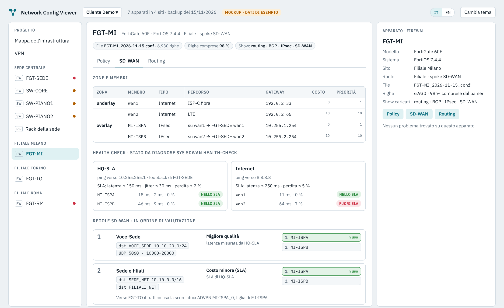
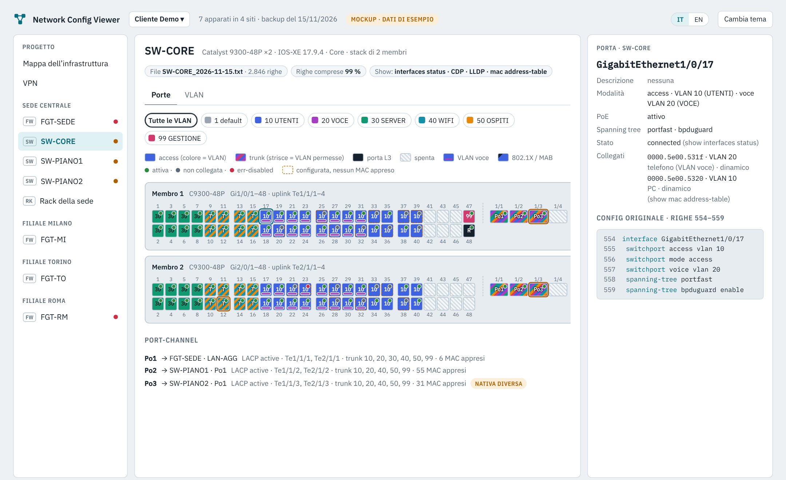
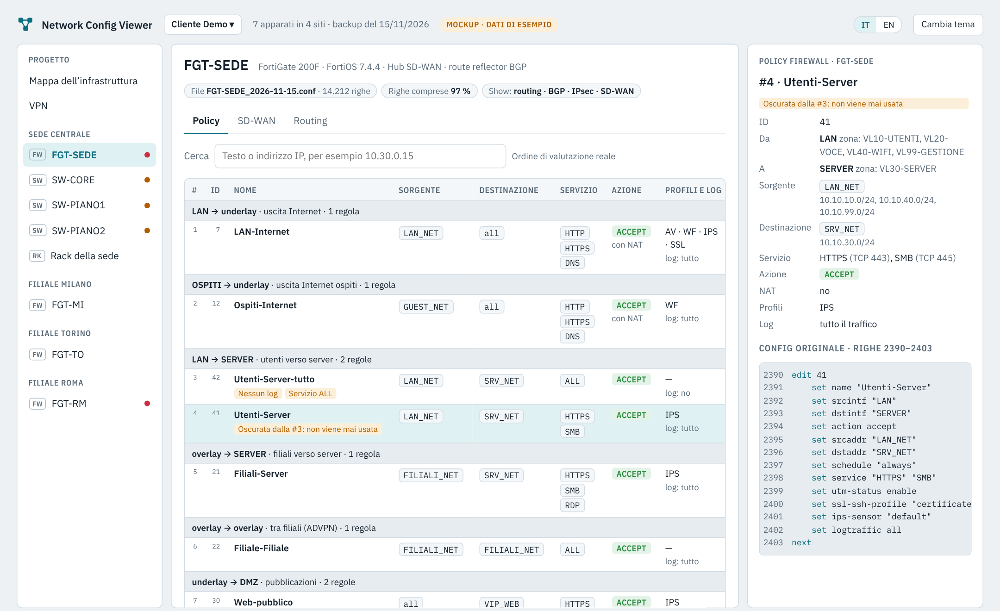
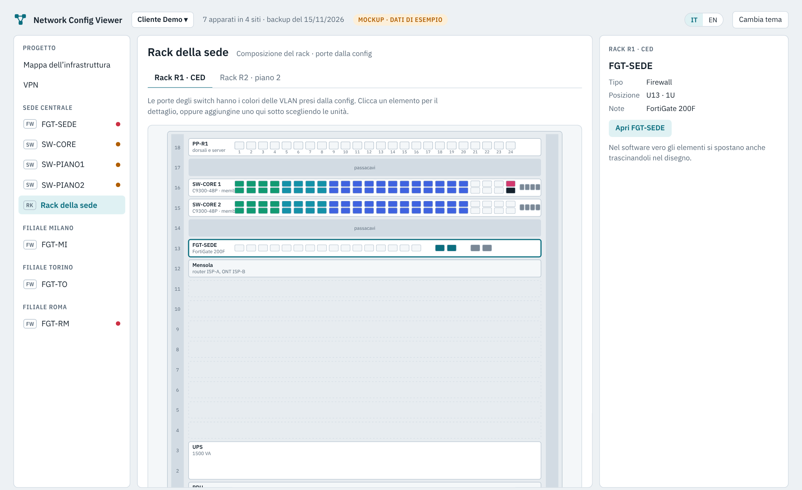
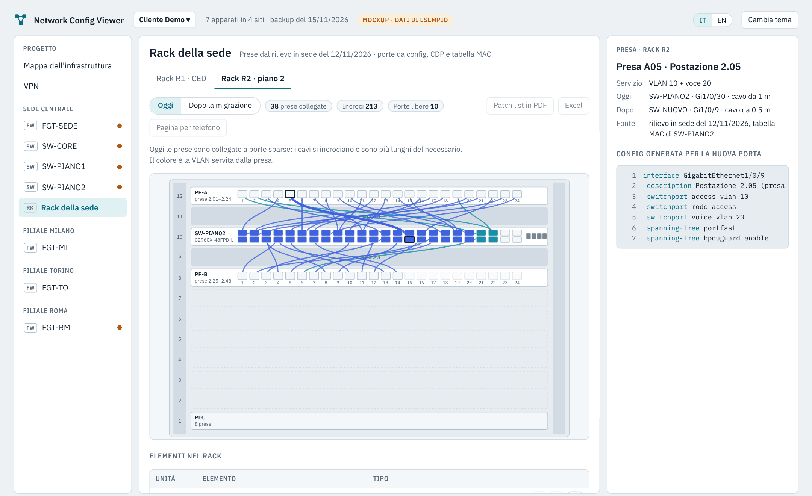
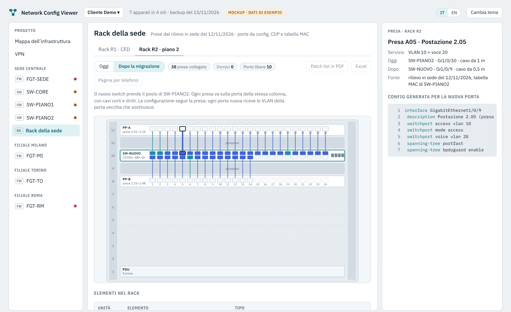

# Studio preliminare: Network Config Viewer

> **Stato:** studio in corso, novembre 2026. Raccoglie le decisioni prese finora e le proposte da validare (vedi [Domande aperte](#12-domande-aperte)). Il [mockup](mockup/index.html) mostra con dati di esempio come potrebbero apparire le viste principali: scarica il file e aprilo nel browser.

## 1. In breve

- **Cosa**: uno strumento per **vedere l'infrastruttura di un cliente** partendo dai backup di configurazione. Ogni cliente ha la sua cartella con config, output di show e versioni precedenti. Si caricano tutti gli apparati (firewall, switch, wireless) e si ottengono:
  - una mappa grafica con collegamenti fisici, VPN, SD-WAN, scorciatoie ADVPN e routing/BGP;
  - le viste di dettaglio di ogni apparato: policy, porte e VLAN, ACL, regole SD-WAN, routing;
  - la vista dei rack, con patch panel e cavi.

  Sulla stessa base lo strumento aiuta a preparare e verificare le migrazioni, comprese quelle degli switch pianificate sul rack da chi lavora da remoto.
- **Come**: un'app web che gira **interamente nel browser**. I file vengono elaborati sul PC e non vengono mai caricati su un server. Più avanti si aggiunge un server opzionale per il lavoro in team e per leggere gli apparati in diretta via SSH/API.
- **Primo traguardo (MVP)**: FortiGate e Cisco IOS/IOS-XE, prima apparato per apparato, poi messi insieme nella mappa dell'infrastruttura.
- **Migrazioni**: arrivano dopo la parte di visualizzazione, su cui si appoggiano. Si parte da ASA, Check Point, Sophos e Juniper verso FortiGate (poi pfSense e OPNsense), in config diretta o tramite FortiManager, con verifica automatica del risultato. Poi le migrazioni switch, pianificate sul rack con la patch list per i tecnici in sede.
- **Licenza**: open source, MIT.
- **Lingua**: interfaccia in italiano e in inglese, a scelta di chi la usa.
- **Chi scrive il codice**: Claude. Tu definisci le priorità, fornisci config di esempio e provi le versioni. Ogni modifica passa da un'issue e parte solo con il tuo okay.



## 2. Decisioni prese

| Tema | Decisione |
|---|---|
| Obiettivo principale | Visualizzare l'infrastruttura del cliente: più apparati insieme, con VPN, SD-WAN, BGP/routing e switch. Non solo convertire config |
| Utenti | All'inizio uso personale in locale, poi il team |
| Avvio in locale | Nel browser, senza installazione |
| Marche da supportare nel tempo | FortiGate, FortiManager, FortiSwitch, FortiAP, Cisco IOS/IOS-XE/NX-OS, Cisco ASA, Aruba/HPE switch (AOS-CX, ArubaOS-Switch, Comware), Aruba Central, Meraki, Check Point, Juniper, Sophos, Netgate pfSense, OPNsense, Ubiquiti (UniFi, EdgeRouter, EdgeSwitch), TP-Link (Omada, JetStream) |
| Primo firewall | FortiGate |
| Primo switch | Cisco IOS/IOS-XE |
| Casi d'uso | Tutti: visualizzazione, migrazione switch, migrazione firewall, in sequenza (vedi [Roadmap](#11-roadmap)) |
| Migrazioni firewall | Tutte le sorgenti verso FortiGate: prima ASA, Check Point, Sophos e Juniper, poi pfSense e OPNsense |
| Destinazioni delle migrazioni | FortiGate, Aruba (CX/AP), Cisco, Meraki |
| FortiConverter | Insufficiente (qualità scarsa, nessun supporto switch): la conversione la facciamo noi, con verifica integrata |
| FortiManager | Sia in lettura (template e policy package esistenti) sia in generazione |
| Input | File caricati a mano e output dei comandi show; lettura live SSH/API in una fase successiva |
| Analisi | Pulizia policy, policy lookup, topologia, confronto tra versioni, controlli di coerenza tra apparati |
| Organizzazione | Una cartella per cliente, con config, output di show, versioni precedenti, file delle prese e collegamenti inseriti a mano |
| Collegamenti tra apparati | Verificati con LLDP/CDP, dedotti da descrizioni e indirizzi, oppure inseriti a mano; le differenze tra le fonti vengono segnalate |
| VPN | Anche ADVPN: ruoli, controlli e scorciatoie tra filiali |
| Migrazioni switch | Pianificate sul rack con i patch panel, per gestire i cablaggi da remoto; arrivano dopo la visualizzazione |
| Prese e patch panel | Oggi i clienti non li documentano: si parte da un rilievo in sede guidato dallo strumento, che poi resta come documentazione |
| Patch list | In tre forme: PDF da stampare per rack, Excel, pagina da telefono con spunta |
| Rack | Si compongono scegliendo cosa mettere e in quali unità: apparati del progetto (firewall, switch…), patch panel, passacavi, mensole, UPS, PDU, pannelli ciechi |
| Wireless | Meraki, FortiAP e Aruba Central |
| Controller UniFi e Omada | Sia locali sia in cloud: servono entrambi i modi di lettura |
| Frontali degli apparati | Per tutti i modelli, ricavati dalla NetBox devicetype-library; frontale generico per i modelli che mancano |
| Lingua dell'interfaccia | Italiano e inglese, a scelta di chi la usa |
| Config reali per lo sviluppo | Disponibili: arrivano dopo l'anonimizzatore (fase 0), in una repo privata separata |
| Licenza | Open source, MIT |
| Codice | Scritto da Claude: lo stack si sceglie per semplicità d'uso, non per familiarità |
| Metodo di lavoro | Ogni proposta viene analizzata e diventa un'issue; si lavora solo dopo l'okay. Registro delle modifiche in `CHANGELOG.md`, documentazione sempre aggiornata, Semantic Versioning. Regole complete in [`CLAUDE.md`](../CLAUDE.md) |

## 3. Architettura



### Principi

1. **Modello neutro al centro.** Ogni parser traduce la config della sua marca in una struttura comune (interfacce, VLAN, LAG, routing, VPN, SD-WAN, ACL, policy, oggetti…). Viste, analisi e migrazioni lavorano solo su quella: aggiungere una marca non richiede di toccare l'interfaccia.
2. **L'infrastruttura è più della somma degli apparati.** Dopo la lettura dei singoli apparati, un passaggio di *correlazione* li collega tra loro:
   - un tunnel IPsec si abbina al peer il cui IP di interfaccia corrisponde al `remote-gw`;
   - una sessione BGP si abbina all'apparato che possiede l'IP del neighbor, anche dentro un range dinamico dell'hub;
   - due interfacce nella stessa subnet diventano un collegamento L3;
   - i vicini LLDP/CDP diventano cavi, e più cavi verso lo stesso vicino diventano un LAG.

   Ogni collegamento riporta la sua fonte: verificato (LLDP/CDP), dedotto (descrizioni, subnet, IP del peer) o inserito a mano. Si può confermare o correggere, e si possono aggiungere collegamenti che nessuna fonte vede, per esempio verso apparati non gestiti. Quando le fonti non sono d'accordo, la differenza viene segnalata: per esempio la descrizione della porta dice un nome e LLDP ne vede un altro.
3. **Lettori e generatori separati.** Per ogni marca possono esistere un *lettore* (parser) e un *generatore* (che scrive la config). Di lettori ne servono tanti, di generatori pochi: solo per le destinazioni delle migrazioni (FortiGate/FortiManager, Aruba, Cisco, Meraki).
4. **Tracciabilità riga per riga.** Ogni oggetto del modello ricorda da quali righe del file proviene, così dalla grafica si salta sempre alla config originale. Ogni riga del file è classificata come *compresa*, *ignorata di proposito* (commenti, banner) o *sconosciuta*, e la percentuale di copertura è sempre visibile. In migrazione è ciò che garantisce di sapere cosa **non** è stato portato.
5. **I default contano.** La running-config non mostra i valori di default: per esempio su un Catalyst una porta senza `switchport mode` non è "access", ma negozia la modalità con DTP. Il parser deve conoscere i default per marca e versione, altrimenti la migrazione perde informazioni senza che nessuno se ne accorga.
6. **Verifica automatica.** Una config generata viene riletta con il parser della marca di destinazione e confrontata con la sorgente: stesse VLAN sulle stesse porte, stesso esito sugli stessi flussi di traffico.

### Parsing in due stadi

1. **Albero sintattico generico**, uno per *famiglia di sintassi* (non per marca), con il numero di riga di ogni nodo:

   | Famiglia di sintassi | Marche |
   |---|---|
   | Indentazione | Cisco IOS/IOS-XE/NX-OS/ASA, Aruba AOS-CX, ArubaOS-Switch, Aruba Instant/controller, TP-Link JetStream, Ubiquiti EdgeSwitch |
   | Blocchi `config / edit / set / next / end` | FortiOS (FortiGate), FortiSwitchOS, script e template CLI di FortiManager |
   | Blocchi separati da `#` + indentazione | HPE Comware |
   | Graffe o comandi `set` | Juniper Junos, Ubiquiti EdgeRouter (EdgeOS), VyOS |
   | JSON | Check Point (ShowPolicyPackage), Meraki, UniFi, Omada, API FortiManager |
   | XML | Sophos Firewall, pfSense, OPNsense |

2. **Driver di marca**: legge l'albero e popola il modello neutro, conoscendo default, nomi delle interfacce e particolarità di ogni versione.

Così il lavoro sulla sintassi si fa una volta per famiglia, e ogni nuova marca costa solo il suo driver.

### Come ottenere l'input per ogni marca

| Marca | Come esportare la configurazione | Formato |
|---|---|---|
| FortiGate | Backup dalla GUI, oppure `show full-configuration` | testo `config/edit/set` |
| FortiSwitch e FortiAP gestiti dal FortiGate | Niente da esportare: la loro configurazione è dentro quella del FortiGate | testo `config/edit/set` |
| FortiSwitch autonomo | Backup della configurazione | testo `config/edit/set` |
| FortiAP e FortiSwitch gestiti dal cloud Fortinet | API (fase server) | JSON |
| FortiManager | Template CLI (testo); policy package e oggetti via API JSON-RPC | testo / JSON |
| Cisco IOS/IOS-XE/NX-OS, ASA | `show running-config` | testo indentato |
| Aruba AOS-CX | `show running-config` | testo indentato |
| ArubaOS-Switch (ex ProCurve) | `show running-config` | testo |
| HPE Comware | `display current-configuration` | testo |
| Juniper (SRX, EX) | `show configuration \| display set` | comandi `set` |
| Check Point | ShowPolicyPackage sul Management Server (tar.gz con JSON), più `show configuration` di Gaia per interfacce e rotte dei gateway | JSON + testo |
| Sophos Firewall | Backup & firmware → Import export → configurazione completa | .tar con `Entities.xml` |
| pfSense (Netgate) | Diagnostics → Backup & Restore → scarica la configurazione | `config.xml` |
| OPNsense | System → Configuration → Backups → scarica la configurazione | `config.xml` |
| Ubiquiti EdgeRouter, VyOS | `show configuration commands` | comandi `set` |
| Ubiquiti EdgeSwitch, TP-Link JetStream | `show running-config` | testo |
| Meraki | Dashboard API (fase server) | JSON |
| Ubiquiti UniFi | API del controller (fase server); il backup del controller è da valutare | JSON |
| TP-Link Omada | API del controller Omada (fase server); il backup del controller è da valutare | JSON |
| Aruba AP | Instant: `show running-config`; controller AOS 8: config del controller; Central: API | testo / JSON |

**FortiSwitch e FortiAP gestiti dal FortiGate.** Con FortiLink e il wireless controller del FortiGate, la configurazione di switch e access point è scritta in quella del FortiGate: porte, VLAN, PoE e MCLAG dei FortiSwitch; SSID, profili radio e access point dei FortiAP. Si leggono quindi insieme al FortiGate, senza file in più.

**Apparati gestiti da controller o dal cloud** (Meraki, UniFi, Omada, Aruba Central, cloud Fortinet). La configurazione non sta nei singoli apparati ma nel controller, che si interroga via API: per questo arrivano con il server (fase 6). Per UniFi e Omada servono sia i controller locali (Cloud Key, UDM, OC200, software su un server) sia quelli in cloud, perché i clienti li hanno entrambi. In cambio il controller conosce già la topologia (a cosa è collegato ogni apparato) e lo stato delle porte, quindi la mappa si costruisce anche senza LLDP. Valuteremo se i file di backup dei controller permettono di anticiparli.

### Comandi show utili

Senza show la mappa mostra la configurazione, cioè cosa *dovrebbe* succedere. Con gli show si sovrappone lo stato reale: cosa succede davvero.

| Comando Cisco | Cosa aggiunge |
|---|---|
| `show version`, `show inventory` | Modello esatto, numeri di serie, membri dello stack |
| `show interfaces status` | Porte up/down, velocità, tipo (rame/SFP) |
| `show vlan brief` | Nomi delle VLAN. **Indispensabile con VTP in modalità server/client**, perché in quel caso le VLAN non sono nella running-config |
| `show etherchannel summary` | Stato dei port-channel |
| `show cdp neighbors detail`, `show lldp neighbors detail` | Collegamenti con altri apparati, quindi la topologia |
| `show mac address-table`, `show ip arp` | Cosa è collegato a ogni porta (utile in migrazione) |
| `show power inline` | Consumo PoE per porta |

| Comando FortiGate | Cosa aggiunge |
|---|---|
| `get system status` | Modello, numero di serie, versione, modalità HA |
| `get system interface physical` | Stato e velocità delle porte |
| `get vpn ipsec tunnel summary`, `diagnose vpn ike gateway list` | Tunnel su o giù, peer collegati (anche dial-up) |
| `get router info routing-table all` | Tabella di routing reale |
| `get router info bgp summary` | Sessioni BGP stabilite e prefissi ricevuti |
| `diagnose sys sdwan health-check`, `diagnose sys sdwan service` | Stato degli SLA e membro scelto da ogni regola SD-WAN (i nomi dei comandi cambiano leggermente tra le versioni) |

## 4. Modello dati neutro (prima bozza)

```
Cliente (una cartella sul PC)
├── Siti (sede, filiali, datacenter…)
├── Rack: elementi per posizione (U): apparati, patch panel, passacavi, UPS…; prese e cavi presa ↔ porta
├── Apparati: hostname, marca, OS e versione, modello, ruolo, sito, file sorgenti
│   ├── Contesti logici: VDOM FortiGate, contesti ASA, virtual system Check Point, logical system Juniper
│   ├── Interfacce: fisiche, LAG, SVI, loopback, tunnel, sotto-interfacce
│   │     L2 (access/trunk, VLAN, nativa, voce) · L3 (IP, VRF, DHCP relay)
│   │     LAG/MLAG (LACP, vPC, VSX, stack) · PoE · STP · 802.1X/MAB
│   │     posizione hardware (membro, slot, porta, tipo rame/SFP)
│   ├── VLAN · VRF
│   ├── Routing: rotte statiche, policy route, BGP (AS, router-id, neighbor, gruppi,
│   │     range dinamici, reti annunciate, redistribuzione, route-map, prefix-list,
│   │     community), OSPF (aree, interfacce)
│   ├── VPN: IPsec fase 1 e fase 2 (peer, proposte, DH, PFS, selettori), GRE,
│   │     ruolo ADVPN (sender/receiver) e scorciatoie attive
│   ├── SD-WAN: zone, membri (underlay/overlay), health check e SLA, regole
│   ├── Zone · oggetti indirizzo e gruppi · servizi e gruppi · schedule · utenti
│   ├── Policy firewall: ordine, interfacce/zone, sorgente, destinazione, servizio,
│   │     azione, NAT, profili di sicurezza, log, commento
│   ├── NAT: VIP, IP pool, regole NAT
│   ├── ACL: voci e punti in cui sono applicate
│   ├── Servizi di gestione: NTP, DNS, SNMP, syslog, AAA/RADIUS/TACACS, utenti locali
│   ├── Apparati gestiti: FortiSwitch e FortiAP collegati al FortiGate
│   ├── Wireless: SSID, sicurezza, VLAN, ruoli, access point e radio
│   ├── Stato da show (facoltativo): porte, tunnel, sessioni BGP, SLA, vicini LLDP/CDP
│   └── Diagnostica: righe non comprese, avvisi del parser
└── Collegamenti tra apparati: tipo (cavo, LAG, subnet, IPsec, overlay SD-WAN, scorciatoia ADVPN,
      BGP, OSPF), estremi, fonte (LLDP/CDP, descrizione, inserito a mano), affidabilità
```

- Ogni elemento porta con sé i riferimenti alle righe sorgente.
- I contesti logici vanno previsti da subito: policy e oggetti appartengono a un contesto (per esempio una VDOM), non direttamente all'apparato.

## 5. Le viste grafiche

Il [mockup](mockup/index.html) contiene le viste 5.1–5.7, 5.9 e 5.11, con un cliente di esempio: una sede con FortiGate hub e tre Catalyst, tre filiali con FortiGate in SD-WAN e ADVPN.

### 5.1 Mappa dell'infrastruttura (vista principale)

- Apparati raggruppati per sito, con il ruolo in evidenza. Internet e i provider sono collegati alle interfacce WAN.
- **Livelli attivabili**: cavi e LAG, subnet condivise, VPN e overlay SD-WAN, scorciatoie ADVPN, sessioni BGP/OSPF.
- **Clic su un collegamento**: i due estremi affiancati. Per esempio:
  - per un tunnel IPsec, fase 1 e fase 2 confrontate parametro per parametro, con le differenze in rosso e il suggerimento per sistemarle;
  - per una sessione BGP, AS, IP, route-map e prefissi;
  - per un trunk, VLAN permesse e nativa dei due lati.
- **Clic su un apparato**: riepilogo e accesso alle sue viste di dettaglio.
- **Collegamenti a mano**: si disegnano trascinando da una porta a un'altra, anche verso apparati che non fanno parte del progetto (un router del provider, un NAS). Restano salvati nella cartella del cliente.
- **Verifica dei cavi con LLDP/CDP**: con gli output dei vicini caricati, ogni cavo risulta verificato, solo dedotto oppure in contrasto con la descrizione della porta. Vengono segnalate anche le porte senza LLDP attivo, dove la verifica non è possibile.
- **Problemi in evidenza**: i collegamenti incoerenti (vedi capitolo 6) sono segnati sulla mappa ed elencati sotto.
- **Stato reale**, se sono stati caricati gli show: tunnel su o giù, BGP stabilito o no, SLA rispettati.
- Siti proposti in automatico (per esempio dal prefisso dell'hostname) e modificabili. Disposizione automatica, con posizioni modificabili e salvate nel progetto.
- **Esportazione in draw.io e immagine**, per la documentazione da consegnare al cliente.

### 5.2 VPN

Elenco dei tunnel di tutto il progetto con i due estremi abbinati, e per ciascuno:

- tipo (statico o dial-up), interfacce e IP;
- IKE, proposte, gruppi DH, PFS, durate;
- selettori di fase 2, ADVPN, IP del tunnel.

Oltre a IPsec, anche WireGuard (i due lati si abbinano con le chiavi pubbliche) e OpenVPN, usati da pfSense, OPNsense e UniFi.

Le topologie hub & spoke sono riconosciute. I tunnel verso peer che non fanno parte del progetto (partner, cloud) sono segnalati come "un solo lato".

**ADVPN**, per le reti hub & spoke in cui le filiali aprono tunnel diretti tra loro:

- ruolo di ogni tunnel: sender sull'hub, receiver sulle filiali;
- controlli: policy che permettono il traffico tra filiali sull'hub e sulle filiali, BGP che non cambia il next hop delle rotte riflesse (serve a far partire le scorciatoie);
- per ogni coppia di filiali: scorciatoia attiva (dagli show), possibile o non possibile, e perché;
- sulla mappa, le scorciatoie attive collegano direttamente le filiali.



### 5.3 SD-WAN



Per ogni FortiGate:

- zone e membri (underlay e overlay), con costi e priorità;
- health check, con i target di SLA (latenza, jitter, perdita) e i membri controllati;
- **regole SD-WAN** nell'ordine di valutazione:
  - cosa intercettano: indirizzi, applicazioni, Internet Service;
  - strategia: manuale, migliore qualità, costo minore entro SLA, massima banda;
  - ordine di preferenza dei membri, con quello in uso evidenziato se c'è lo show.

  In fondo c'è la regola implicita.

Sulla mappa, gli overlay SD-WAN collegano filiali e hub. Le stesse viste valgono per il multi-WAN degli altri vendor, per esempio i gateway group di pfSense e OPNsense.

### 5.4 Routing e BGP

- **Per apparato**: rotte statiche, policy route, BGP (neighbor, gruppi, range dinamici dell'hub, reti annunciate, redistribuzioni, route-map e prefix-list espanse), OSPF.
- **Sulla mappa**: sessioni BGP abbinate tra apparati, con AS, iBGP o eBGP e route reflector.
- **Tabella di routing reale**, se caricata da show, con evidenziate le rotte attese che mancano (per esempio la LAN di una filiale la cui sessione BGP non è su). Senza show, la tabella mostra le rotte che derivano dalla config: connesse, statiche, reti annunciate.

### 5.5 Pannello porte dello switch



Disegno del frontale, con un riquadro per ogni membro dello stack:

- **Colore** = VLAN access. La stessa VLAN ha lo stesso colore su tutti gli apparati del progetto, così si confrontano a colpo d'occhio switch vecchio e nuovo.
- **Trunk a strisce**, una striscia per ogni VLAN permessa. Ci sono segni anche per porta L3, porta spenta, membro di port-channel, vPC/VSX, PoE, 802.1X/MAB e VLAN voce.
- **Stato reale** (attiva, non collegata, err-disabled), se è stato caricato `show interfaces status`.
- **Filtro VLAN**: scelta una VLAN, si evidenziano tutte le porte che la trasportano (access, trunk, nativa).
- **Clic su una porta**: tutta la configurazione, il vicino CDP/LLDP, cosa è collegato (dalla tabella MAC) e le righe originali.
- **Vista logica di LAG e MLAG**: i due switch della coppia vPC/VSX, il peer-link, il keepalive e i port-channel verso il basso.
- **Disposizione delle porte**:
  - in prima battuta generica, ricavata dai nomi delle interfacce: porte dispari sopra e pari sotto, uplink a parte, un blocco per membro;
  - poi frontali realistici per tutti i modelli, ricavati dalla [NetBox devicetype-library](https://github.com/netbox-community/devicetype-library): migliaia di modelli con elenco e tipo di porte, con licenza CC0 e quindi riutilizzabile liberamente; per i modelli che mancano resta il frontale generico;
  - il modello si ricava dalla config stessa (per esempio `switch 1 provision c9300-48p` su Cisco, l'intestazione `#config-version=FGT60F-…` su FortiGate) oppure da `show inventory`.
- Lo stesso pannello serve per le **interfacce del FortiGate** (port1…, wan, x1/x2 SFP+) e per i **FortiSwitch** gestiti dal FortiGate, comprese le coppie MCLAG.

### 5.6 VLAN

Per ogni VLAN: nome, **gateway** (anche se si trova su un altro apparato del progetto, per esempio la sotto-interfaccia del FortiGate), numero di porte access, voce e trunk, e una striscia con tutte le porte nell'ordine del frontale. È il riferimento principale nelle migrazioni switch.

### 5.7 Policy firewall



Tabella in stile GUI FortiGate:

- **Ordine reale di valutazione**: conta la sequenza nel file, non l'ID. Si può vedere per coppia di interfacce o come lista unica.
- **Oggetti come etichette**: al passaggio del mouse i gruppi si espandono fino agli IP; con un clic si apre l'oggetto con l'elenco dei punti **dove è usato**.
- **Ricerca** testuale e **per IP**: trova le regole che coinvolgono 10.30.0.15, anche tramite subnet, gruppi e "all".
- **Avvisi**: regole oscurate, disabilitate, senza log, any-any, con sorgente "all" su servizi di gestione.
- **Viste collegate**: VIP/NAT, IP pool, interfacce e zone, rotte statiche.
- **Altri vendor**: la vista segue il modello di ognuno. Per esempio pfSense e OPNsense hanno regole per interfaccia d'ingresso, con le regole floating valutate per prime.

### 5.8 ACL degli switch

Elenco delle ACL con le voci, gli object-group espansi e i **punti in cui sono applicate** (interfaccia e direzione, VTY, SNMP, NAT, route-map…). Usa lo stesso motore di ricerca e di lookup delle policy firewall.

### 5.9 Config originale collegata

Testo originale con evidenziazione della sintassi, blocchi piegabili e numeri di riga. I nomi degli oggetti sono cliccabili (portano alla definizione) e le righe non comprese dal parser sono evidenziate. Ogni dettaglio (porta, policy, tunnel) indica le righe da cui proviene.

### 5.10 Riepilogo dell'apparato

Hostname, modello, versione, IP di gestione, conteggi (interfacce, VLAN, policy, oggetti), funzioni in uso (stack, vPC, VSX, 802.1X, OSPF, SD-WAN…), show caricati e percentuale di copertura del parser.

### 5.11 Rack e patch panel



- **Composizione del rack**: si sceglie cosa mettere e in quali unità. Si possono inserire gli apparati del progetto (firewall, switch, controller…) ed elementi generici: patch panel da 24 o 48 porte, passacavi, mensole, UPS, PDU, pannelli ciechi. Gli elementi si spostano trascinandoli e un sito può avere più rack.
- Le porte degli apparati mostrano i colori delle VLAN presi dalla config, con i frontali realistici di ogni modello. Cliccando un elemento si apre l'apparato corrispondente.



- Ogni presa collegata alla sua porta, con il colore della VLAN che serve. Cliccando una presa si vede cosa c'è dall'altra parte: utenza, porta, VLAN, telefono o PC (dalla tabella MAC).
- **Da dove arrivano i dati**: le porte dalle config e dagli show. Prese e patch panel oggi non sono documentati, quindi si parte da un **rilievo in sede** guidato dallo strumento:
  - una pagina da telefono elenca le prese di ogni patch panel; per ciascuna il tecnico indica la porta dello switch, oppure "libera";
  - lo strumento propone le corrispondenze probabili e mostra cosa c'è su ogni porta (telefono, PC, AP, dalla tabella MAC e da LLDP), così il tecnico conferma invece di scrivere;
  - con la lettura live (fase 6) basterà staccare e riattaccare un cavo alla volta: lo strumento riconosce da solo la porta che cambia stato;
  - il rilievo resta nella cartella del cliente come documentazione per le volte successive.
- Quando esistono, si possono importare anche file dell'installatore (CSV o Excel) o dati da NetBox.
- È la base per le migrazioni switch pianificate da remoto (vedi 7.3).

## 6. Analisi

| Funzione | Cosa fa |
|---|---|
| **Controlli di coerenza** | Confronta gli estremi di ogni collegamento e trova: tunnel IPsec con proposte, gruppi DH o selettori incompatibili; sessioni BGP con AS sbagliato o senza il neighbor dall'altro lato; rotte attese che mancano; trunk con VLAN nativa o permesse diverse; LACP configurato da un solo lato; MTU diverse; IP duplicati e subnet sovrapposte tra siti (un problema classico con VPN e SD-WAN); scorciatoie ADVPN che non possono partire; descrizioni delle porte in contrasto con LLDP/CDP. |
| **Policy lookup** | Dato un flusso (IP sorgente, IP destinazione, protocollo e porta, interfaccia d'ingresso), indica quale regola lo gestisce e perché. Vale sia per le policy firewall sia per le ACL. In seguito proseguirà **tra le sedi**: policy della filiale, regola SD-WAN scelta, tunnel, policy dell'hub. |
| **Pulizia policy** | Trova regole oscurate da regole precedenti (shadowed) o ridondanti, oggetti inutilizzati, oggetti duplicati (stesso valore, nome diverso), gruppi vuoti, any-any, regole disabilitate o senza log. Serve soprattutto **prima** di una migrazione, per non portarsi dietro regole e oggetti inutili. |
| **Confronto versioni** | Mostra le differenze tra due backup dello stesso apparato: non solo nel testo, ma anche nel significato (policy, oggetti, porte, VLAN, tunnel, rotte aggiunti, rimossi o modificati). |
| **Topologia** | Disegna lo schema degli apparati collegati (la mappa del capitolo 5.1), ricavato da LLDP/CDP, subnet condivise, VPN, BGP e descrizioni delle porte. |

**Limite da tenere presente**: lavorando offline non ci sono i contatori di utilizzo delle regole (hit count), né la risoluzione di FQDN, geolocalizzazione e Internet Service. Le regole che dipendono da questi elementi vengono segnalate come "non valutabili".

## 7. Migrazioni

### 7.1 Flusso generale

1. Si carica la config sorgente, e se possibile gli output dei comandi show.
2. Si sceglie la destinazione: marca, modello, versione.
3. **Mappatura**: interfacce e zone (firewall) o porte (switch), con una tabella e con il trascinamento sui frontali. È previsto anche il consolidamento (più apparati vecchi su uno nuovo).
4. **Trasformazioni**: rinomina di oggetti e interfacce, rinumerazione delle VLAN, sostituzione con gli oggetti predefiniti della destinazione (per esempio i servizi HTTP/HTTPS del FortiGate).
5. **Compatibilità**: ogni funzione della sorgente viene tradotta, segnalata come da rivedere o segnalata come non supportata, mai scartata in silenzio.
6. **Output**:
   - la config di destinazione;
   - un report (HTML/Excel) con mappature, avvisi e righe non migrate;
   - per gli switch, la **patch list** per i tecnici in campo ("cavo dalla porta 1/0/12 vecchia alla porta 2/0/5 nuova").
7. **Verifica**: la config generata viene riletta e confrontata con la sorgente.

### 7.2 Firewall verso FortiGate

**Sorgenti**: tutte. Ordine: ASA (testo, la più diffusa), Check Point, Sophos, Juniper, poi pfSense e OPNsense.

**Perché non basta FortiConverter.** Fortinet ha un tool ufficiale per questa migrazione, [FortiConverter](https://docs.fortinet.com/document/forticonverter/7.0.3/online-help/220359), ma l'esperienza sul campo è che la qualità del risultato non basta e che non copre gli switch. La conversione quindi la facciamo noi, con queste caratteristiche:

- **pulizia prima della migrazione** (oggetti inutilizzati, regole oscurate), per non portarsi dietro regole e oggetti inutili;
- **revisione visiva** di sorgente e destinazione affiancate, sulla mappa e nelle viste di dettaglio;
- **verifica di equivalenza integrata**: per ogni regola della sorgente si generano flussi di prova e si controlla che il FortiGate dia lo stesso esito. La verifica funziona anche su config prodotte da altri strumenti o scritte a mano.

**Cosa si converte**: interfacce e zone, oggetti, servizi, policy, NAT, **e anche VPN, routing e SD-WAN**. Per esempio: crypto map ASA verso VPN IPsec del FortiGate basate su interfaccia, community VPN di Check Point, tunnel `st0` e sessioni BGP di Juniper.

**Output**:

- config FortiOS da applicare al FortiGate;
- **script CLI per FortiManager** da eseguire sulla destinazione "Policy Package o ADOM Database" (oggetti e policy), oppure template CLI per il provisioning;
- report di migrazione e report di equivalenza.

**Punti difficili:**

- **ASA**: le ACL sono applicate all'interfaccia d'ingresso, mentre il FortiGate vuole sia l'interfaccia di ingresso **sia** quella di uscita. Quella di uscita va ricavata dalla tabella di routing, e una regola può dover essere divisa in più policy. Il NAT (object NAT e twice NAT) va tradotto in VIP, IP pool o central NAT. Le VPN basate su crypto map diventano VPN basate su interfaccia.
- **Check Point**: layer e inline layer, regole implicite, oggetti dinamici. Inoltre la policy sta sul Management Server, mentre le interfacce stanno sui gateway.
- **Sophos**: tipi di regola diversi (rete, utente, WAF) e oggetti propri.
- **pfSense e OPNsense**: come per ASA, le regole sono per interfaccia d'ingresso e quella di uscita va ricavata dal routing. Gli alias diventano oggetti, i port forward diventano VIP, i gateway group diventano SD-WAN. I tunnel WireGuard e OpenVPN vanno ripensati come IPsec.
- **In generale**: limiti di lunghezza e di caratteri nei nomi, mappatura dei servizi predefiniti, schedule, utenti e gruppi.

Una volta pronti lettore e generatore FortiOS, anche il **refresh FortiGate → FortiGate** (modello nuovo, interfacce rimappate) arriva quasi gratis.

### 7.3 Migrazioni switch

Arrivano dopo la parte di visualizzazione, su cui si appoggiano (lettori, modello neutro, mappa, rack).

- Refresh Cisco (per esempio Catalyst 2960/3750/3850 → 9200/9300) e Cisco → Aruba AOS-CX, compresa la traduzione vPC → VSX, port-security e 802.1X.
- **Pianificazione sul rack**, pensata per chi gestisce i cablaggi da remoto:
  1. se prese e patch panel non sono documentati, si parte dal rilievo in sede (vedi 5.11);
  2. si posiziona il nuovo switch nel rack;
  3. lo strumento propone il cablaggio migliore: ogni presa sulla porta della stessa colonna, con cavi corti e senza incroci (oppure raggruppati per VLAN, se si preferisce);
  4. la configurazione segue la presa: ogni porta nuova riceve VLAN, voce, 802.1X e descrizione della porta vecchia che sostituisce;
  5. escono la config del nuovo switch e la **patch list** per i tecnici in sede, divisa per rack ("presa A05: dalla Gi1/0/30 del vecchio switch alla Gi1/0/9 del nuovo, cavo da 0,5 m"), in tre forme: PDF da stampare, Excel e pagina da telefono dove il tecnico spunta ogni spostamento;
  6. dopo il cambio si caricano LLDP, tabella MAC e stato porte del nuovo switch: lo strumento verifica che ogni presa sia finita sulla porta prevista e segnala le differenze.
- Consolidamento di più switch su uno stack, con la stessa logica.



### 7.4 Meraki e cloud

Meraki non ha una config testuale: lettura e scrittura passano dalla Dashboard API, che richiede il server (fase 6).

## 8. Scelte tecniche

**Linguaggio: TypeScript per tutto.** Motivi:

- i parser girano direttamente nel browser: niente upload e niente installazione;
- un solo linguaggio e un solo modello dati, condiviso tra parser e interfaccia;
- lo stesso codice girerà anche sul server per il team, senza riscriverlo;
- l'alternativa (backend Python + interfaccia web) richiederebbe due linguaggi e, già nella fase locale, un programma da installare o Docker.

Il punto forte di Python (librerie SSH come Netmiko) serve solo per la lettura live, che arriva con il server. Lì la scelta resta aperta, perché il raccoglitore live è un componente separato che produce gli stessi file di testo dei backup.

| Area | Proposta |
|---|---|
| Interfaccia | React + Vite, con una libreria di componenti da scegliere nella fase 0 (per esempio Mantine) |
| Tabelle grandi (migliaia di policy) | TanStack Table con virtualizzazione |
| Pannelli porte | SVG disegnato da codice |
| Mappa e schemi LAG/vPC | React Flow con layout automatico, esportazione in draw.io |
| Config originale | CodeMirror 6 (evidenziazione, piegatura, salto alla riga) |
| Elaborazione | Web Worker, così l'interfaccia non si blocca sui file grandi |
| Archivi zip e tar.gz | fflate |
| Cartelle dei clienti | Una cartella per cliente sul PC, letta e aggiornata direttamente dal browser (Chrome ed Edge lo permettono); negli altri browser, salvataggio interno al browser con import/export in zip |
| Export | Excel (ExcelJS), report HTML stampabile in PDF |
| Test | Vitest (parser e logica), Playwright (interfaccia) |
| Struttura del codice | Monorepo: `core` (modello, parser, correlazione, generatori, analisi, senza dipendenze dal browser), `web` (interfaccia), in futuro `server` |

La licenza di ogni libreria va verificata prima di adottarla: deve essere compatibile con la licenza MIT del progetto.

**Distribuzione.** La repo è pubblica, quindi l'app si può pubblicare gratis su **GitHub Pages** e si apre da un link; i file restano comunque nel browser. Per gli ambienti senza internet si può scaricare un pacchetto offline.

**Lingua.** Interfaccia in italiano e in inglese fin dalla prima versione, con la lingua scelta da chi la usa; codice e nomi tecnici in inglese. I termini di rete d'uso comune (VLAN, trunk, policy) restano invariati in entrambe le lingue.

## 9. Sicurezza e riservatezza

- **Le config dei clienti non lasciano il PC**: tutto viene elaborato nel browser, senza telemetria e senza chiamate esterne.
- **La repo è pubblica, quindi niente config reali nella repo.** I file di test devono essere sintetici o anonimizzati.
- **Config reali per lo sviluppo**: dopo la fase 0 le anonimizzi con lo strumento stesso, nel tuo browser. Poi le metti in una repo privata separata (per esempio `Network-Config-Samples`), che viene collegata alle sessioni di sviluppo quando serve.
- **Anonimizzatore integrato** (fase 0). Sostituisce password e hash, PSK, community SNMP e certificati. Sostituisce anche indirizzi IP, hostname, utenti e descrizioni in modo coerente: stessa sostituzione ovunque e subnet preservate, così VPN e BGP tra apparati restano abbinabili. Serve a creare file di test sicuri e a condividere config con colleghi o con il supporto dei vendor.
- **Segreti mascherati** nell'interfaccia, visibili con un clic.
- **File di progetto** salvati in locale, con cifratura opzionale tramite password.
- **Licenza MIT**: chiunque può usare, modificare e ridistribuire il codice, anche commercialmente, mantenendo l'avviso di copyright (vedi [LICENSE](../LICENSE)).

## 10. Qualità e test

- **Raccolta di config di esempio** per ogni marca e versione (sintetiche o anonimizzate), ciascuna con il modello atteso salvato accanto: ogni modifica ai parser viene verificata su tutta la raccolta.
- **Progetti di esempio multi-apparato** (sede e filiali con VPN, SD-WAN e BGP) per verificare la correlazione e i controlli di coerenza.
- **Copertura** misurata per ogni file: percentuale di righe comprese.
- **Andata e ritorno** per i generatori: modello → config → rilettura → stesso modello.
- **Test differenziali** per le migrazioni: stessi flussi di prova, stesso esito su sorgente e destinazione.
- **Test automatici dell'interfaccia** con screenshot.
- **CI su GitHub Actions**: ogni modifica viene testata e, se tutto va bene, pubblicata.

## 11. Roadmap

Ogni fase si chiude con qualcosa che puoi aprire e provare. L'ordine delle fasi 4–6 si può rivedere strada facendo.

### Fase 0: fondamenta
- Struttura del progetto, CI, pubblicazione su GitHub Pages.
- Caricamento file (anche zip) e riconoscimento automatico di marca, OS e modello.
- Parser generici e vista della config originale.
- Anonimizzatore.
- Interfaccia in italiano e inglese fin dall'inizio.
- **Risultato**: trascini un backup FortiGate o Cisco, l'app lo riconosce e mostra la config navigabile. Puoi anonimizzare le config reali e passarmele.

### Fase 1: lettura dei singoli apparati FortiGate e Cisco IOS/IOS-XE (MVP)
- FortiGate: interfacce e zone, oggetti, policy (con VDOM), VIP e IP pool, routing (statiche, BGP, OSPF), VPN IPsec, SD-WAN.
- Cisco: interfacce, VLAN, trunk, port-channel, stack, SVI, ACL, routing.
- Output dei comandi show di entrambi.
- Cartella per cliente: si apre una cartella con config, show e versioni precedenti, e lo strumento la legge tutta.
- Viste per apparato (5.3–5.10) ed export Excel.
- **Risultato**: ogni FortiGate e ogni Catalyst leggibile in forma grafica.

### Fase 2: mappa dell'infrastruttura
- Progetto con più apparati e siti; correlazione (cavi, LAG, subnet, IPsec, overlay SD-WAN, BGP).
- Mappa a livelli, vista VPN con ADVPN, dettaglio dei collegamenti, controlli di coerenza, stato reale dagli show.
- Verifica dei cavi con LLDP/CDP e collegamenti inseriti a mano.
- FortiSwitch e FortiAP gestiti dal FortiGate: pannello porte, MCLAG, SSID e access point.
- Esportazione in draw.io e immagine.
- **Risultato**: carichi le config di sede e filiali e vedi la rete del cliente, con i problemi evidenziati.

### Fase 3: analisi e rack
- Policy lookup (poi anche tra le sedi), pulizia policy, confronto tra versioni.
- Rack: composizione (apparati, patch panel, passacavi, UPS… nelle loro unità), frontali realistici per tutti i modelli, rilievo delle prese in sede da telefono.
- **Risultato**: risposte del tipo "questo traffico passa?", report di pulizia e rack del cliente documentati.

### Fase 4: altri firewall e conversione verso FortiGate
- Lettori ASA, Check Point, Sophos e Juniper, poi pfSense, OPNsense e Ubiquiti EdgeRouter, con le stesse viste e presenti nella mappa.
- Conversione verso FortiGate (FortiOS e FortiManager) con verifica integrata; lettura dei template CLI FortiManager.
- **Risultato**: config FortiGate generata, verificata e accompagnata dal report.

### Fase 5: altri switch e migrazioni switch
- Lettori NX-OS (vPC), AOS-CX (VSX), ArubaOS-Switch, Comware, Aruba Instant, TP-Link JetStream, Ubiquiti EdgeSwitch, FortiSwitch autonomi.
- Import delle prese da CSV/Excel o NetBox, quando esistono.
- Pianificazione del cablaggio sul rack, mappatura porte con consolidamento, generatori AOS-CX e IOS-XE, traduzione vPC → VSX.
- Patch list per rack in PDF, Excel e pagina da telefono con spunta; verifica dopo il cambio con LLDP, tabella MAC e stato porte.
- **Risultato**: config del nuovo switch, patch list per i tecnici e controllo del lavoro fatto in sede.

### Fase 6: server per il team e lettura live
- La stessa app su un server (Docker), con progetti condivisi e utenti.
- Lettura via SSH/API: FortiGate, FortiManager (policy package), Meraki, UniFi e Omada (controller locali e in cloud), Aruba Central, cloud Fortinet per FortiAP e FortiSwitch, Cisco.
- Apparati gestiti da controller o dal cloud (Meraki, UniFi, Omada, Aruba Central) e wireless nella mappa e nelle viste; Meraki anche come destinazione delle migrazioni.
- Rilievo delle prese assistito dalla lettura live: si stacca un cavo e lo strumento riconosce la porta.
- **Risultato**: lo strumento usato dal team, con import diretto dagli apparati.

## 12. Domande aperte

Nessuna domanda aperta blocca l'inizio dei lavori. Durante lo sviluppo serviranno le config reali, anonimizzate con lo strumento della fase 0.

## Riferimenti

- [NetBox devicetype-library](https://github.com/netbox-community/devicetype-library): definizioni dei modelli hardware (licenza CC0).
- [Check Point ShowPolicyPackage](https://github.com/CheckPointSW/ShowPolicyPackage): export di policy e oggetti in HTML e JSON via Management API.
- [FortiManager: script](https://docs.fortinet.com/document/FortiManager/7.6.6/administration-guide/990788/scripts) e [creare oggetti con uno script CLI](https://community.fortinet.com/t5/FortiManager/Technical-Tip-How-to-create-Policy-Objects-in-FortiManager-using/ta-p/285268).
- [FortiConverter: versioni e conversioni supportate](https://docs.fortinet.com/document/forticonverter/7.0.3/online-help/220359).
- [Sophos Firewall: import/export della configurazione](https://www.avanet.com/en/kb/sophos-firewall-configuration-import-export/) (guida di terze parti).
- [Batfish](https://github.com/batfish/batfish): strumento open source di analisi delle configurazioni multi-vendor, utile come riferimento per policy lookup e controlli di coerenza.
