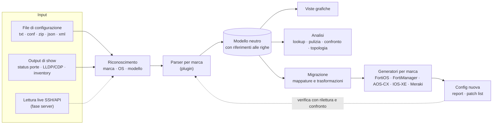

# Studio preliminare: Network Config Viewer

> **Stato:** bozza di studio, novembre 2026. Raccoglie le decisioni prese nella prima sessione di analisi e le proposte ancora da validare (vedi [Domande aperte](#12-domande-aperte)).

## 1. In breve

- **Cosa**: un'applicazione che legge i backup di configurazione di apparati di rete di marche diverse, li mostra in forma grafica (policy firewall, ACL, porte e VLAN degli switch, port-channel, vPC/VSX…) e aiuta a preparare e verificare le migrazioni.
- **Come**: un'app web che gira **interamente nel browser**. I file vengono elaborati sul PC e non vengono mai caricati su un server. Più avanti si aggiunge un server opzionale per il lavoro in team e per leggere gli apparati in diretta via SSH/API.
- **Primo traguardo (MVP)**: lettura e visualizzazione di **FortiGate** e **Cisco IOS/IOS-XE**.
- **Prima migrazione**: **altri firewall → FortiGate**, in config diretta o tramite FortiManager.
- **Chi scrive il codice**: Claude. Tu definisci le priorità, fornisci config di esempio e provi le versioni.

## 2. Decisioni prese

| Tema | Decisione |
|---|---|
| Utenti | All'inizio uso personale in locale, poi il team |
| Avvio in locale | Nel browser, senza installazione |
| Marche da supportare nel tempo | FortiGate, FortiManager, Cisco IOS/IOS-XE/NX-OS, Cisco ASA, Aruba/HPE switch (AOS-CX, ArubaOS-Switch, Comware), wireless Aruba e Meraki, Check Point, Juniper, Sophos |
| Primo firewall | FortiGate |
| Primo switch | Cisco IOS/IOS-XE |
| Casi d'uso | Tutti: lettura policy, porte/VLAN, migrazione switch, migrazione firewall (in sequenza, vedi [Roadmap](#11-roadmap)) |
| Destinazioni delle migrazioni | FortiGate, Aruba (CX/AP), Cisco, Meraki |
| Prima migrazione | Altri firewall → FortiGate |
| FortiManager | Sia in lettura (template e policy package esistenti) sia in generazione |
| Input | File caricati a mano e output dei comandi show; lettura live SSH/API in una fase successiva |
| Analisi | Pulizia policy, policy lookup, topologia, confronto tra versioni |
| Codice | Scritto da Claude: lo stack si sceglie per semplicità d'uso, non per familiarità |

## 3. Architettura



### Principi

1. **Modello neutro al centro.** Ogni parser traduce la config della sua marca in una struttura comune (interfacce, VLAN, LAG, ACL, policy, oggetti…). Viste, analisi e migrazioni lavorano solo su quella: aggiungere una marca non richiede di toccare l'interfaccia.
2. **Lettori e generatori separati.** Per ogni marca possono esistere un *lettore* (parser) e un *generatore* (scrive la config). Di lettori ne servono tanti, di generatori pochi: solo per le destinazioni delle migrazioni (FortiGate/FortiManager, Aruba, Cisco, Meraki).
3. **Tracciabilità riga per riga.** Ogni oggetto del modello ricorda da quali righe del file proviene, così dalla grafica si salta sempre alla config originale. Ogni riga del file è classificata come *compresa*, *ignorata di proposito* (commenti, banner) o *sconosciuta*, e la percentuale di copertura è sempre visibile. In migrazione è ciò che garantisce di sapere cosa **non** è stato portato.
4. **I default contano.** La running-config non mostra i valori di default: per esempio su un Catalyst una porta senza `switchport mode` non è "access", ma negozia la modalità con DTP. Il parser deve conoscere i default per marca e versione, altrimenti la migrazione perde informazioni senza che nessuno se ne accorga.
5. **Verifica automatica.** Una config generata viene riletta con il parser della marca di destinazione e confrontata con la sorgente: stesse VLAN sulle stesse porte, stesso esito sugli stessi flussi di traffico.

### Parsing in due stadi

1. **Albero sintattico generico**, uno per *famiglia di sintassi* (non per marca), con il numero di riga di ogni nodo:

   | Famiglia di sintassi | Marche |
   |---|---|
   | Indentazione | Cisco IOS/IOS-XE/NX-OS/ASA, Aruba AOS-CX, ArubaOS-Switch, Aruba Instant/controller |
   | Blocchi `config / edit / set / next / end` | FortiOS (FortiGate), script e template CLI di FortiManager |
   | Blocchi separati da `#` + indentazione | HPE Comware |
   | Graffe o comandi `set` | Juniper Junos |
   | JSON | Check Point (ShowPolicyPackage), Meraki, API FortiManager |
   | XML | Sophos Firewall |

2. **Driver di marca**: legge l'albero e popola il modello neutro, conoscendo default, nomi delle interfacce e particolarità di ogni versione.

Così il lavoro sulla sintassi si fa una volta per famiglia, e ogni nuova marca costa solo il suo driver.

### Come ottenere l'input per ogni marca

| Marca | Come esportare la configurazione | Formato |
|---|---|---|
| FortiGate | Backup dalla GUI, oppure `show full-configuration` | testo `config/edit/set` |
| FortiManager | Template CLI (testo); policy package e oggetti via API JSON-RPC | testo / JSON |
| Cisco IOS/IOS-XE/NX-OS, ASA | `show running-config` | testo indentato |
| Aruba AOS-CX | `show running-config` | testo indentato |
| ArubaOS-Switch (ex ProCurve) | `show running-config` | testo |
| HPE Comware | `display current-configuration` | testo |
| Juniper (SRX, EX) | `show configuration \| display set` | comandi `set` |
| Check Point | ShowPolicyPackage sul Management Server (tar.gz con JSON), più `show configuration` di Gaia per interfacce e rotte dei gateway | JSON + testo |
| Sophos Firewall | Backup & firmware → Import export → configurazione completa | .tar con `Entities.xml` |
| Meraki | Dashboard API (fase server) | JSON |
| Aruba AP | Instant: `show running-config`; controller AOS 8: config del controller; Central: API | testo / JSON |

### Comandi show utili (Cisco)

Insieme alla running-config, questi output arricchiscono molto le viste:

| Comando | Cosa aggiunge |
|---|---|
| `show version`, `show inventory` | Modello esatto, numeri di serie, membri dello stack |
| `show interfaces status` | Porte up/down, velocità, tipo (rame/SFP) |
| `show vlan brief` | Nomi delle VLAN. **Indispensabile con VTP in modalità server/client**, perché in quel caso le VLAN non sono nella running-config |
| `show etherchannel summary` | Stato dei port-channel |
| `show cdp neighbors detail`, `show lldp neighbors detail` | Collegamenti con altri apparati, quindi la topologia |
| `show mac address-table`, `show ip arp` | Cosa è collegato a ogni porta (utile in migrazione) |
| `show power inline` | Consumo PoE per porta |

## 4. Modello dati neutro (prima bozza)

```
Progetto (cliente / sito)
└── Apparato: hostname, marca, OS e versione, modello, ruolo, file sorgenti
    ├── Contesti logici: VDOM FortiGate, contesti ASA, virtual system Check Point, logical system Juniper
    ├── Interfacce: fisiche, LAG, SVI, loopback, tunnel, sotto-interfacce
    │     L2 (access/trunk, VLAN, nativa, voce) · L3 (IP, VRF, DHCP relay)
    │     LAG/MLAG (LACP, vPC, VSX, stack) · PoE · STP · 802.1X/MAB
    │     posizione hardware (membro, slot, porta, tipo rame/SFP)
    ├── VLAN · VRF · rotte statiche · (OSPF/BGP in seguito)
    ├── Zone · oggetti indirizzo e gruppi · servizi e gruppi · schedule · utenti
    ├── Policy firewall: ordine, interfacce/zone, sorgente, destinazione, servizio,
    │     azione, NAT, profili di sicurezza, log, commento
    ├── NAT: VIP, IP pool, regole NAT
    ├── ACL: voci e punti in cui sono applicate (interfaccia e direzione, VTY, SNMP…)
    ├── Servizi di gestione: NTP, DNS, SNMP, syslog, AAA/RADIUS/TACACS, utenti locali
    ├── (in seguito) VPN IPsec, SD-WAN, wireless (SSID, sicurezza, VLAN, ruoli)
    └── Diagnostica: righe non comprese, avvisi del parser
Collegamenti tra apparati (da LLDP/CDP, descrizioni delle porte o inseriti a mano)
```

- Ogni elemento porta con sé i riferimenti alle righe sorgente.
- I contesti logici vanno previsti da subito: policy e oggetti appartengono a un contesto (per esempio una VDOM), non direttamente all'apparato.

## 5. Le viste grafiche

### 5.1 Pannello porte dello switch

Disegno del frontale, con un riquadro per ogni membro dello stack:

```
 SW-PIANO1 · membro 1 · C9300-48P
      1    3    5    7    9    11        45   47               uplink
    ┌────┬────┬────┬────┬────┬────┐    ┌────┬────┐   ┌─────┬─────┬─────┬─────┐
    │ 10 │ 10 │ 10 │ 20 │ 10 │ ░░ │ ·· │ T  │ T  │   │ Po1 │ Po1 │  -  │  -  │
    ├────┼────┼────┼────┼────┼────┤    ├────┼────┤   └─────┴─────┴─────┴─────┘
    │ 10 │ 10 │ 30 │ 20 │ ░░ │ 10 │ ·· │ R  │ T  │    1/1/1 1/1/2 1/1/3 1/1/4
    └────┴────┴────┴────┴────┴────┘    └────┴────┘
      2    4    6    8    10   12        46   48

 10/20/30 = VLAN access (un colore per VLAN)   T = trunk   R = porta L3
 ░░ = porta spenta   Po1 = membro del port-channel 1 (LACP)
```

- **Colore** = VLAN access. La stessa VLAN ha lo stesso colore su tutti gli apparati del progetto, così si confrontano a colpo d'occhio switch vecchio e nuovo.
- **Simboli** per trunk (VLAN nativa e permesse al passaggio del mouse), porta L3, porta spenta, membro di port-channel, vPC/VSX, PoE, 802.1X/MAB, port-security, VLAN voce.
- **Stato reale** (porta attiva, spenta, err-disabled) se è stato caricato `show interfaces status`.
- **Filtro VLAN**: scelta una VLAN, si evidenziano tutte le porte che la trasportano (access, trunk, nativa).
- **Clic su una porta**: pannello laterale con tutta la configurazione e le righe originali.
- **Vista logica di LAG e MLAG**: i due switch della coppia vPC/VSX, il peer-link, il keepalive e i port-channel verso il basso.
- **Disposizione delle porte**:
  - in prima battuta generica, ricavata dai nomi delle interfacce: porte dispari sopra e pari sotto, uplink a parte, un blocco per membro;
  - poi frontali realistici per modello, usando la [NetBox devicetype-library](https://github.com/netbox-community/devicetype-library): migliaia di modelli con elenco e tipo di porte, con licenza CC0 e quindi riutilizzabile liberamente;
  - il modello si ricava dalla config stessa (per esempio `switch 1 provision c9300-48p` su Cisco, l'intestazione `#config-version=FGT60F-…` su FortiGate) oppure da `show inventory`.
- Lo stesso pannello serve per le **interfacce del FortiGate** (port1…, wan, x1/x2 SFP+).

### 5.2 Matrice VLAN × porte

Tabella con le VLAN sulle righe e le porte sulle colonne (U = untagged, T = tagged, N = nativa). Mostra subito quale porta trasporta quale VLAN ed è il riferimento principale nelle migrazioni switch.

### 5.3 Policy firewall

Tabella in stile GUI FortiGate, raggruppata per coppia di interfacce:

```
 #   ID  Nome          Sorgente  Destinazione  Servizio     Azione  NAT  Profili    Log
 ──────────────────────────────────────────────────────────────────────────────────────
 ▼ internal → wan1  (12 regole)
 1   7   LAN-Internet  LAN_NET   all           HTTP, HTTPS  ACCEPT  sì   AV WF IPS  tutto
 2   3   Blocco-P2P    all       all           BitTorrent   DENY    -    -          tutto
 ▼ wan1 → dmz  (4 regole)
 13  21  Web-pubblico  all       VIP_WEB       HTTPS        ACCEPT  -    IPS        tutto
```

- **Ordine reale di valutazione**: conta la sequenza nel file, non l'ID. Si può vedere per coppia di interfacce o come lista unica.
- **Oggetti come etichette**: al passaggio del mouse i gruppi si espandono fino agli IP; con un clic si apre l'oggetto con l'elenco dei punti **dove è usato**.
- **Ricerca** testuale e **per IP**: trova le regole che coinvolgono 10.1.2.3, anche tramite subnet e gruppi.
- **Evidenze**: regole disabilitate attenuate, any-any, regole senza log, profili di sicurezza mancanti.
- **Viste collegate**: VIP/NAT, IP pool, interfacce e zone, rotte statiche.

### 5.4 ACL degli switch

Elenco delle ACL con le voci, gli object-group espansi e i **punti in cui sono applicate** (interfaccia e direzione, VTY, SNMP, NAT, route-map…). Usa lo stesso motore di ricerca e di lookup delle policy firewall.

### 5.5 Config originale collegata

Testo originale con evidenziazione della sintassi, blocchi piegabili e numeri di riga. I nomi degli oggetti sono cliccabili (portano alla definizione) e le righe non comprese dal parser sono evidenziate.

### 5.6 Riepilogo dell'apparato

Hostname, modello, versione, IP di gestione, conteggi (interfacce, VLAN, policy, oggetti), funzioni in uso (stack, vPC, VSX, 802.1X, OSPF…) e percentuale di copertura del parser.

## 6. Analisi

| Funzione | Cosa fa |
|---|---|
| **Policy lookup** | Dato un flusso (IP sorgente, IP destinazione, protocollo e porta, interfaccia d'ingresso) indica quale regola lo gestisce e perché. Vale sia per le policy firewall sia per le ACL. |
| **Pulizia policy** | Trova regole oscurate da regole precedenti (shadowed) o ridondanti, oggetti inutilizzati, oggetti duplicati (stesso valore, nome diverso), gruppi vuoti, any-any, regole disabilitate o senza log. Serve soprattutto **prima** di una migrazione, per non portarsi dietro regole e oggetti inutili. |
| **Confronto versioni** | Mostra le differenze tra due backup dello stesso apparato: non solo nel testo, ma anche nel significato (policy, oggetti, porte, VLAN aggiunti, rimossi o modificati). |
| **Topologia** | Disegna lo schema degli apparati collegati, ricavato da LLDP/CDP e dalle descrizioni delle porte, con LAG e coppie vPC/VSX evidenziati. |

**Limite da tenere presente**: lavorando offline non ci sono i contatori di utilizzo delle regole (hit count), né la risoluzione di FQDN, geolocalizzazione e Internet Service. Le regole che dipendono da questi elementi vengono segnalate come "non valutabili".

## 7. Migrazioni

### 7.1 Flusso generale

1. Si carica la config sorgente, e se possibile gli output dei comandi show.
2. Si sceglie la destinazione: marca, modello, versione.
3. **Mappatura**: interfacce e zone (firewall) o porte (switch), con una tabella e con il trascinamento sui frontali. È previsto anche il consolidamento (più apparati vecchi su uno nuovo).
4. **Trasformazioni**: rinomina di oggetti e interfacce, rinumerazione delle VLAN, sostituzione con gli oggetti predefiniti della destinazione (per esempio i servizi HTTP/HTTPS del FortiGate).
5. **Compatibilità**: ogni funzione della sorgente viene tradotta, segnalata come da rivedere o segnalata come non supportata, mai scartata in silenzio.
6. **Output**:
   - la config di destinazione;
   - un report (HTML/Excel) con mappature, avvisi e righe non migrate;
   - per gli switch, la **patch list** per i tecnici in campo ("cavo dalla porta 1/0/12 vecchia alla porta 2/0/5 nuova").
7. **Verifica**: la config generata viene riletta e confrontata con la sorgente.

### 7.2 Prima migrazione: altri firewall → FortiGate

**Strumenti esistenti.** Fortinet ha già un tool ufficiale per questa migrazione, [FortiConverter](https://docs.fortinet.com/document/forticonverter/7.0.3/online-help/220359), che dichiara il supporto di ASA, Check Point, Sophos e Juniper verso FortiGate. Il nostro strumento non deve rifarlo uguale, ma coprire ciò che manca:

- **pulizia prima della migrazione** (oggetti inutilizzati, regole oscurate);
- **revisione visiva** di sorgente e destinazione affiancate;
- **verifica di equivalenza** della config FortiGate risultante, anche se prodotta da FortiConverter o scritta a mano;
- tutta la **parte switch e wireless**, che FortiConverter non copre.

**Proposta: prima la verifica, poi la conversione.**

- **Passo A, verifica**: lettore del firewall sorgente, lettore FortiGate (già pronto dalla fase 1) e **report di equivalenza**. Per ogni regola della sorgente si generano flussi di prova e si controlla che il FortiGate dia lo stesso esito. È utile da subito, qualunque strumento abbia fatto la conversione.
- **Passo B, conversione**: un motore di conversione nostro, che produce:
  - la config FortiOS da applicare al FortiGate;
  - uno **script CLI per FortiManager** da eseguire sulla destinazione "Policy Package o ADOM Database" (oggetti e policy), oppure template CLI per il provisioning;
  - il report di migrazione.

**Punti difficili** (sono il motivo per cui la verifica è preziosa):

- **ASA**: le ACL sono applicate all'interfaccia d'ingresso, mentre il FortiGate vuole sia l'interfaccia di ingresso **sia** quella di uscita. Quella di uscita va ricavata dalla tabella di routing, e una regola può dover essere divisa in più policy. Il NAT (object NAT e twice NAT) va tradotto in VIP, IP pool o central NAT.
- **Check Point**: layer e inline layer, regole implicite, oggetti dinamici. Inoltre la policy sta sul Management Server, mentre le interfacce stanno sui gateway.
- **Sophos**: tipi di regola diversi (rete, utente, WAF) e oggetti propri.
- **In generale**: limiti di lunghezza e di caratteri nei nomi, mappatura dei servizi predefiniti, schedule, utenti e gruppi.

Una volta pronti lettore e generatore FortiOS, anche il **refresh FortiGate → FortiGate** (modello nuovo, interfacce rimappate) arriva quasi gratis.

### 7.3 Migrazioni switch (fase successiva)

- Refresh Cisco (per esempio Catalyst 2960/3750/3850 → 9200/9300) e Cisco → Aruba AOS-CX, compresa la traduzione vPC → VSX, port-security e 802.1X.
- Mappatura porte vecchio → nuovo anche con consolidamento su stack, patch list, verifica per rilettura.

### 7.4 Meraki e cloud

Meraki non ha una config testuale: lettura e scrittura passano dalla Dashboard API, che richiede il server (fase 6).

## 8. Scelte tecniche

**Linguaggio: TypeScript per tutto.** Motivi:

- i parser girano direttamente nel browser: niente upload e niente installazione;
- un solo linguaggio e un solo modello dati, condiviso tra parser e interfaccia;
- lo stesso codice girerà anche sul server per il team, senza riscriverlo;
- l'alternativa (backend Python + interfaccia web) richiederebbe due linguaggi e, già nella fase locale, un programma da installare o Docker.

Il punto forte di Python (librerie SSH come Netmiko) serve solo per la lettura live, che arriva con il server. Lì la scelta resta aperta, perché il raccoglitore live è un componente separato che produce gli stessi file di testo dei backup.

| Area | Proposta |
|---|---|
| Interfaccia | React + Vite, con una libreria di componenti da scegliere nella fase 0 (per esempio Mantine) |
| Tabelle grandi (migliaia di policy) | TanStack Table con virtualizzazione |
| Pannelli porte | SVG disegnato da codice |
| Topologia e schemi LAG/vPC | React Flow con layout automatico |
| Config originale | CodeMirror 6 (evidenziazione, piegatura, salto alla riga) |
| Elaborazione | Web Worker, così l'interfaccia non si blocca sui file grandi |
| Archivi zip e tar.gz | fflate |
| Salvataggio progetti | Nel browser (IndexedDB), con esportazione e importazione in un file di progetto |
| Export | Excel (ExcelJS), report HTML stampabile in PDF |
| Test | Vitest (parser e logica), Playwright (interfaccia) |
| Struttura del codice | Monorepo: `core` (modello, parser, generatori, analisi, senza dipendenze dal browser), `web` (interfaccia), in futuro `server` |

La licenza di ogni libreria va verificata prima di adottarla.

**Distribuzione.** La repo è pubblica, quindi l'app si può pubblicare gratis su **GitHub Pages** e si apre da un link; i file restano comunque nel browser. Per gli ambienti senza internet si può scaricare un pacchetto offline.

**Lingua.** Codice e nomi tecnici in inglese, interfaccia in italiano predisposta per l'inglese (da confermare).

## 9. Sicurezza e riservatezza

- **Le config dei clienti non lasciano il PC**: tutto viene elaborato nel browser, senza telemetria e senza chiamate esterne.
- **La repo è pubblica, quindi niente config reali nella repo.** I file di test devono essere sintetici o anonimizzati.
- **Anonimizzatore integrato** (fase 0). Sostituisce password e hash, PSK, community SNMP e certificati. Sostituisce anche indirizzi IP, hostname e utenti in modo coerente: stessa sostituzione ovunque e subnet preservate. Serve a creare file di test sicuri e a condividere config con colleghi o con il supporto dei vendor.
- **Segreti mascherati** nell'interfaccia, visibili con un clic.
- **File di progetto** salvati in locale, con cifratura opzionale tramite password.
- **Licenza**: oggi la repo non ne ha. Senza licenza il codice è visibile, ma nessuno può riusarlo legalmente. Va deciso (vedi [Domande aperte](#12-domande-aperte)).

## 10. Qualità e test

- **Raccolta di config di esempio** per ogni marca e versione (sintetiche o anonimizzate), ciascuna con il modello atteso salvato accanto: ogni modifica ai parser viene verificata su tutta la raccolta.
- **Copertura** misurata per ogni file: percentuale di righe comprese.
- **Andata e ritorno** per i generatori: modello → config → rilettura → stesso modello.
- **Test differenziali** per le migrazioni: stessi flussi di prova, stesso esito su sorgente e destinazione.
- **Test automatici dell'interfaccia** con screenshot.
- **CI su GitHub Actions**: ogni modifica viene testata e, se tutto va bene, pubblicata.

## 11. Roadmap

Ogni fase si chiude con qualcosa che puoi aprire e provare. L'ordine delle fasi 4–6 si può rivedere strada facendo.

### Fase 0: fondamenta
- Struttura del progetto, CI, pubblicazione su GitHub Pages.
- Caricamento file (anche zip) e riconoscimento automatico di marca, OS e modello.
- Parser generici e vista della config originale.
- Anonimizzatore.
- **Risultato**: trascini un backup FortiGate o Cisco, l'app lo riconosce e mostra la config navigabile.

### Fase 1: lettura FortiGate + Cisco IOS/IOS-XE (MVP)
- FortiGate: interfacce e zone, oggetti, policy (con VDOM), VIP e IP pool, rotte statiche.
- Cisco: interfacce, VLAN, trunk, port-channel, stack, SVI, ACL, rotte, output dei comandi show.
- Viste dei paragrafi 5.1–5.6 ed export Excel.
- **Risultato**: le due viste chiave (policy e pannello porte) funzionanti su config reali.

### Fase 2: analisi
- Policy lookup, pulizia policy, confronto tra versioni.
- **Risultato**: risposte del tipo "questo traffico passa?" e report di pulizia.

### Fase 3: altri firewall → FortiGate
- Lettore del firewall sorgente scelto, con la sua vista policy.
- Passo A: report di equivalenza sorgente ↔ FortiGate.
- Passo B: conversione, con generatore FortiOS, script FortiManager e lettura dei template CLI FortiManager.
- **Risultato**: prima il report di equivalenza, poi la config FortiGate generata e verificata.

### Fase 4: più marche e topologia
- Altri lettori: ASA, Check Point, Sophos, Juniper, NX-OS (vPC), AOS-CX (VSX), ArubaOS-Switch, Comware, Aruba Instant.
- Topologia da LLDP/CDP, frontali realistici per modello.
- **Risultato**: le stesse viste per tutte le marche, più lo schema della rete.

### Fase 5: migrazioni switch
- Mappatura porte con consolidamento, patch list.
- Generatori AOS-CX e IOS-XE, traduzione vPC → VSX.
- **Risultato**: config del nuovo switch e patch list per i tecnici.

### Fase 6: server per il team e lettura live
- La stessa app su un server (Docker), con progetti condivisi e utenti.
- Lettura via SSH/API: FortiGate, FortiManager (policy package), Meraki, Aruba Central, Cisco.
- Meraki e wireless come sorgenti e destinazioni delle migrazioni.
- **Risultato**: lo strumento usato dal team, con import diretto dagli apparati.

## 12. Domande aperte

1. **Firewall sorgente della prima migrazione**: ASA, Check Point, Sophos o Juniper? Qual è il più frequente nei tuoi progetti?
2. **FortiConverter**: lo usi già? Cosa non ti soddisfa? Dalla risposta dipende se partire dalla verifica (passo A) o dalla conversione (passo B).
3. **Config di esempio**: hai config reali di FortiGate, Catalyst e del firewall sorgente da usare durante lo sviluppo? Non vanno messe in questa repo, che è pubblica: si possono passare in sessione o tenere in una repo privata separata. L'anonimizzatore della fase 0 serve anche a questo.
4. **Licenza**: open source (per esempio MIT o Apache-2.0), oppure codice visibile ma non riutilizzabile?
5. **Modelli hardware più frequenti** (Catalyst e FortiGate), per dare priorità ai frontali realistici.
6. **Wireless**: quali piattaforme usi (Aruba Instant, controller AOS 8, Central/AOS 10, Meraki MR)?
7. **Lingua dell'interfaccia**: va bene l'italiano, con l'inglese in un secondo momento?

## Riferimenti

- [NetBox devicetype-library](https://github.com/netbox-community/devicetype-library): definizioni dei modelli hardware (licenza CC0).
- [Check Point ShowPolicyPackage](https://github.com/CheckPointSW/ShowPolicyPackage): export di policy e oggetti in HTML e JSON via Management API.
- [FortiManager: script](https://docs.fortinet.com/document/FortiManager/7.6.6/administration-guide/990788/scripts) e [creare oggetti con uno script CLI](https://community.fortinet.com/t5/FortiManager/Technical-Tip-How-to-create-Policy-Objects-in-FortiManager-using/ta-p/285268).
- [FortiConverter: versioni e conversioni supportate](https://docs.fortinet.com/document/forticonverter/7.0.3/online-help/220359).
- [Sophos Firewall: import/export della configurazione](https://www.avanet.com/en/kb/sophos-firewall-configuration-import-export/) (guida di terze parti).
- [Batfish](https://github.com/batfish/batfish): strumento open source di analisi delle configurazioni multi-vendor, utile come riferimento per il policy lookup.
